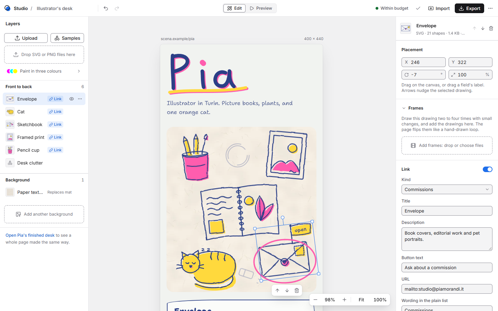
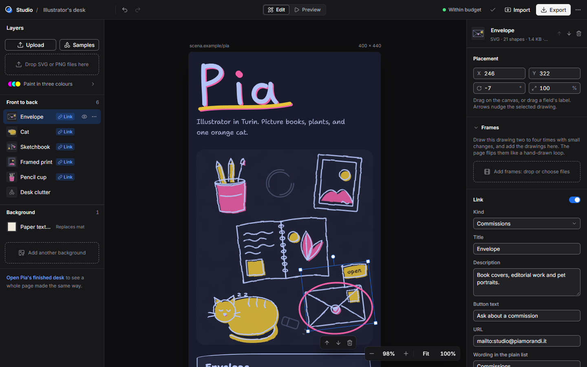
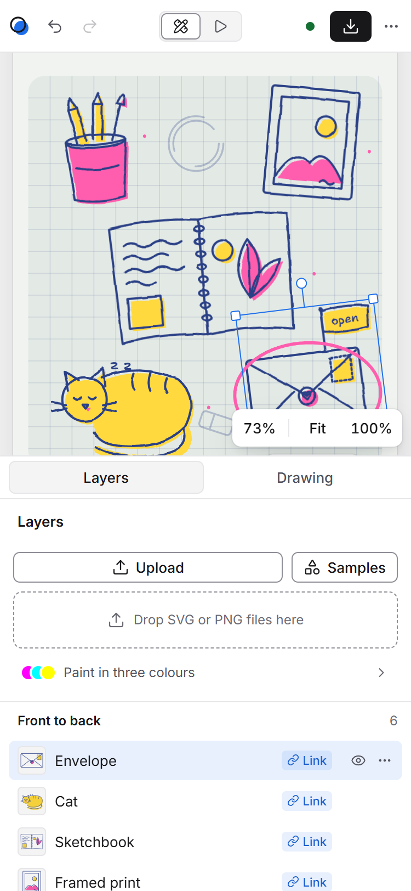

# Scena (working name)

[](https://github.com/ChronosSF/scena/actions/workflows/ci.yml)

An illustrated link-in-bio. Instead of a list of buttons, a person's page is a drawing: tap the
sketchbook for the portfolio, the envelope for commissions, the cat for the newsletter. The
platform adds the life to any drawing: hand-drawn line boil, a lift on hover, a ring that draws
itself, a reveal panel, a plain-text list for screen readers, light and dark mode, and reduced
motion.

This repository holds the scene format, the renderer that turns a scene and a page into one
self-contained HTML file, and the **studio**: an illustrator drops in their own drawings (SVG,
or PNG from Procreate), marks which ones are clickable, attaches links, and exports the page.
The studio also has the plan's first product in it, a links-only mode: a ready-made scene whose
drawings are fixed, where a person fills in the links, the words and the colours. The scene is
chosen in a picker whose cards are the page itself, live, not pictures of it.
The studio runs in two places from the same code: as one HTML file that opens from disk, for
pitching, and inside the web app, which is where sign-in, saved drafts and publishing are built.
Today the web app has the studio and sign-in: a visitor tries the studio first and signs in
from its top bar, by an emailed link or code, or by Google, and comes back to their work. Once
signed in, a page on a ready-made scene is saved to their account two seconds after they stop
typing, and opens on their other devices.
The product plan is in [docs/development-plan.md](docs/development-plan.md); the work it describes is
tracked as [milestones and issues on GitHub](https://github.com/ChronosSF/scena/milestones).

## Stack

- TypeScript end to end in a pnpm workspace; Node 24 runs the scripts directly.
- `@scena/scene`, `@scena/renderer` and `@scena/scenes` are pure TypeScript packages, used as source with no build step.
- The page runtime is compiled by esbuild and inlined with a CSP hash; it is under 3 KB.
- The studio is a React 19 package, `@scena/studio`. Its interface uses headless Radix primitives
  (menus, popovers, tooltips) and Lucide icons, styled by hand; the design system is in
  [docs/design/studio-ui.md](docs/design/studio-ui.md). Two apps mount it:
  - `apps/studio` builds it with Vite 8 into one HTML file that opens from disk.
  - `apps/web` is Next.js 16 (App Router). It loads the studio in the browser only, at `/studio`.
- Both apps carry a Content Security Policy, so markup from a document cannot run script even
  if a sanitiser misses it. The single-file build names the bundled app and the page runtime by
  hash, at build time. The web app names its scripts by a nonce made for each request, and the
  page runtime by hash. The Vite dev server has no policy; `pnpm verify:studio` and
  `pnpm verify:web` check the builds in a browser.
- `@scena/db` is the database, for server code only: Postgres 17 through Drizzle ORM and
  postgres.js, with migrations written by drizzle-kit from the schema. It holds users, pages,
  reserved handles and the audit log. A page's draft is stored as the PageDocument it is, and
  only once the scene package's validators have passed it. The web app makes a person's profile
  with it at their first sign-in, and keeps a signed-in person's draft in it through a server
  action. Locally it runs in Docker (below).
- Sign-in is Supabase Auth, used from the web app's server alone through `@supabase/ssr`: the
  session is in an `HttpOnly` cookie of the app's own host, renewed by `proxy.ts`, and no
  Supabase client or key reaches a browser. It is built and checked against Supabase's local
  stack in Docker (below); no hosted Supabase project exists yet.
- Vitest for tests, `tsc` 7 for type checks, headless Chrome over CDP for end-to-end checks.

Why this and not the plan's full stack yet: [docs/adr/0001-tech-stack.md](docs/adr/0001-tech-stack.md).
How the studio came to run in two apps: [docs/adr/0004-one-studio-two-apps.md](docs/adr/0004-one-studio-two-apps.md).
The database package, its schema and why: [docs/adr/0005-database-package.md](docs/adr/0005-database-package.md).
Sign-in, the session cookie, the local stack, and what a hosted Supabase project will need: [docs/adr/0006-sign-in.md](docs/adr/0006-sign-in.md).
Saving the draft to the account, two tabs, and which draft opens: [docs/adr/0007-server-autosave.md](docs/adr/0007-server-autosave.md).

## Commands

Needs Node 24 or later and pnpm 10 (`corepack enable` gets the pinned pnpm).

```sh
pnpm install
pnpm dev          # the studio with hot reload at http://localhost:5173 (and /demo-desk.html)
pnpm dev:web      # the web app with hot reload at http://localhost:3100 (the studio is at /studio)
pnpm build        # both apps: pnpm build:studio, then pnpm build:web
pnpm build:studio # apps/studio/dist/index.html (the studio), dist/demo-desk.html and dist/demo-frames.html, all self-contained
pnpm build:web    # the web app's production build, in apps/web/.next
pnpm preview      # serve the single-file build at http://localhost:4173
pnpm test         # 392 tests: renderer snapshots and parity, scene model, lint and safety checks, the list of ready-made scenes, studio editing operations, the scene picker, the links-only mode, the check on messages from the preview, saved work, file sniffing, both apps' policies, frames, board and lettering, sign-in's rules (the way back, the session cookie, the configuration, what a person is told, the profile, the renewal of a session, what a browser is given, the local stack's settings), saving the draft to the account (what the server decides, which draft opens, the autosave in the browser, the studio's part of it), and the database package (25 of them need a database, below)
pnpm typecheck    # every package, both apps, the page runtime, the scripts and the tools
pnpm check        # typecheck + db:check + test + build

pnpm lint:scene packages/scenes/desk.scene.json packages/scenes/pia.page.json
```

### The local database

Needs Docker. `compose.yaml` runs Postgres 17 as one container, `scena-postgres`, on
`127.0.0.1:5435`, reachable from this machine only. The image is named by its digest, the same
one CI uses, so everyone runs the build that was tried:

```sh
docker compose up -d --wait   # start it, and wait until it takes connections
docker compose stop           # stop it; the data stays
docker compose down -v        # remove it and its data, for a clean start
```

Everything reads the database's address from `DATABASE_URL`; `.env.example` has the local one.
Set it in your shell (`export DATABASE_URL=…`, or `$env:DATABASE_URL = "…"` in PowerShell). With
it set, `pnpm test` and `pnpm check` also run the 25 database tests, each run in a database of
its own that it makes, migrates and removes, so the tests neither read nor leave anything in
yours. A run that is cut short leaves its database behind; the next run removes it once it is
an hour old. Without `DATABASE_URL`, Vitest reports those 25 as skipped. CI runs them against a
Postgres 17 service.

```sh
pnpm db:migrate   # applies the migrations the database at DATABASE_URL has not had, then the reserved handles; safe to repeat
pnpm db:generate  # after a change to packages/db/src/schema.ts: writes the migration for it into packages/db/migrations
pnpm db:check     # fails when the schema and the migrations disagree (needs no database; pnpm check runs it too)
```

### Sign-in and the local Supabase stack

Needs Docker. `supabase/config.toml` describes a local Supabase stack with only what sign-in
uses: Supabase Auth, the gateway in front of it, its Postgres, and Mailpit, a mail catcher that
keeps every email the stack sends. The Supabase CLI runs at one pinned version, fetched by pnpm
the first time (`tools/stack.ts`); it is not installed with the workspace.

```sh
pnpm stack:start            # start it, and apply the app's migrations to its database (the first start pulls about 2 GB of images)
pnpm stack:stop             # stop it; the data stays in its Docker volume
pnpm stack:remove           # stop it and remove its volume, for a clean start
pnpm stack:env              # the web app's variables for it, as KEY=value lines (--powershell: $env:KEY = "value")
pnpm stack:env --write      # the same, into apps/web/.env.local, which Next.js reads and git ignores; the file's other lines stay
```

To try sign-in: `pnpm stack:start`, then `pnpm stack:env --write`, then `pnpm dev:web`, and open
http://localhost:3100/studio. The emails arrive at http://127.0.0.1:54424, and the sign-in page
offers to type the code from them. The stack's containers are `supabase_db_scena`,
`supabase_auth_scena`, `supabase_kong_scena` and `supabase_inbucket_scena`, on ports 54421 (the
gateway), 54422 (Postgres) and 54424 (the mail catcher). **The CLI publishes them on every
network interface, not on 127.0.0.1 alone, and its database password is a well-known local
one**: stop the stack on a network you do not trust.

To try saving to the account: signed in, choose a ready-made scene (More, "Choose a ready-made
scene…") and type a link's title. The indicator in the top bar says "Saving…", then "Saved" two
seconds after the last keystroke; the page is in `pages` in the stack's database, with no
handle yet. Open the studio in a second tab and edit there to see the first tab say "Changed
elsewhere"; cut the connection in the browser's developer tools to see "Offline, retrying". A
page on drawings of your own stays in the browser, and the indicator says so. Sign in on a
second browser and edit there, then reload the first: the newer version opens, and nothing is
asked. `pnpm stack:start` applies the app's migrations each time; a stack that was already
running when a migration was added needs `pnpm db:migrate`, with `DATABASE_URL` set from
`pnpm stack:env`.

`/admin` opens for a profile with `is_admin` set, which nothing in the app sets. On the local
stack, after signing in once:

```sh
docker exec supabase_db_scena psql -U postgres -c "update users set is_admin = true where email = 'you@example.com'"
```

Google sign-in is off unless switched on in both places: the app with `SCENA_GOOGLE_SIGN_IN=on`,
and the stack by starting it with `SUPABASE_AUTH_EXTERNAL_GOOGLE_ENABLED=true` and the client id
and secret from Google's console in `SUPABASE_AUTH_EXTERNAL_GOOGLE_CLIENT_ID` and
`SUPABASE_AUTH_EXTERNAL_GOOGLE_SECRET`. No Google credentials exist for this project yet.

Other tools, all optional:

| Command | What it does |
|---|---|
| `pnpm gen` | Rebuilds the page runtime into `packages/renderer/src/runtime.generated.ts` (dev, build, test and typecheck run it first) |
| `pnpm encode:desk` | Regenerates `desk.scene.json` and `pia.page.json` from the hand-encoding of the original prototype |
| `pnpm encode:samples` | Regenerates `samples.json`: the frame-animated steaming mug sample |
| `pnpm fixtures` | Regenerates the test drawings in `fixtures/`, including the mug's three SVG frames, a blinking face as a PNG sequence and as an animated PNG, a paper texture, a drawn desk top and a lettered "Pia" (SVG and PNG) |
| `pnpm parity` | Confirms the renderer reproduces the prototype's `demo-desk.html` (apart from the runtime) |
| `pnpm verify:studio [url]` | Drives the studio in headless Chrome through real mouse, touch, keyboard and file-chooser input, including taps in the preview that bring up a link's form and keep its panel open, and the page in its place, while it is edited, on a desktop and at 375 px, and the way back to the page's settings. Default target: the build from file://. Run `pnpm build` first |
| `pnpm verify:web [url]` | Starts the built web app's own server and drives it in headless Chrome: the policy the server sends with every page, the studio loading in the browser only, the scene picker, a link filled in by typing, a tap in the preview that opens the page's panel and brings up the link's form, a reload, markup and added scripts that try to run, and the home page before and after a visit to the studio. Then sign-in against the local stack, each person in a browser of their own, reading the emails from the mail catcher: from the studio and back with the work by the link and by the code, the link in a second browser, wrong, used and older links and codes, the cookie as the browser holds it, a session renewed by the proxy, `/admin`, sign-out, the refusals, Google, a phone, and the studio's top bar at the widths between a phone and a wide window. Then the draft saved to the account: a visitor unchanged, a page on one's own drawings kept in the browser, the page made by the first save, an edit in the database two seconds after the last keystroke, a reload, another device, a reload inside the two seconds, the connection cut and back, a draft the server refuses, the save action called without a session, two tabs, a device looked at again, signing in where the account has another version, switching devices back and forth, and the top bar with the indicator's words. Run `pnpm build` and `pnpm stack:start` first; without the stack the sign-in and autosave checks are reported as skipped. With a URL it checks a server that is already running, such as `pnpm dev:web` with the stack's variables |
| `pnpm verify:runtime` | Checks every branch of the boil control (lite mode, slow device, Save-Data, reduced motion, offscreen, hidden, idle) on the built demo page, that frames flip, hold frame 1 and pause with it on `demo-frames.html`, that the demo page in a frame posts nothing to its parent when a drawing is tapped and never scrolls itself (only the studio's preview renders a page that does either), and that the runtime reads the page's own data whatever ids its drawing holds |
| `pnpm shots [url]` | Retakes the studio screenshots in `docs/design/` (desktop light and dark, 375 px). Default target: the build from file:// |
| `pnpm measure [--soft]` | Boil frame cost at 375×812 @3x with 1×, 4× and 6× CPU slowdown, against the original prototype; then the desk with three objects flipping frames at 6 fps |

The Chrome-based tools use the installed Chrome or Edge (or set `CHROME_PATH`). They write
screenshots and exports to `tools/out/`, which git ignores.

Next.js reports anonymous usage to its maker unless `NEXT_TELEMETRY_DISABLED=1` is set in the
environment. CI sets it, and so does `pnpm verify:web` for the server it starts. The Supabase CLI
does the same unless `SUPABASE_TELEMETRY_DISABLED=1` is set; `pnpm stack:*` sets it.

## Layout

```
packages/
  scene/       SceneDocument and PageDocument types, validateScene / validatePage / migrate, lintScene
  renderer/    renderPage, renderParts, CSS, geometry, escaping; runtime/ is the page script
  scenes/      the ready-made scenes and their sample pages (desk.scene.json, pia.page.json) as a list,
               samples.json (the steaming mug), their encoders, and testing/ (a second scene for the checks)
  studio/      the studio as a React component, with its store, stylesheet and tests;
               src/ingest/ has the SVG sanitiser and the PNG pipeline
  db/          the database (server only): src/schema.ts (the tables), the typed queries, the
               reserved handles; migrations/ (written by drizzle-kit, checked in); scripts/
               for db:migrate and db:check
apps/
  studio/      the studio as one HTML file (Vite): the entry point, the build and its policy
  web/         the web app (Next.js): the studio at /studio, sign-in (/sign-in, /auth/*, /admin),
               auth/ (the server side of sign-in), drafts/ (the draft saved to the account: the
               server actions, what they decide, and the autosave in the browser), proxy.ts and
               the policy sent with every page
supabase/      the local Supabase stack for sign-in: config.toml, the sign-in email, and the one
               migration the stack's database needs before the app's own
fixtures/      test drawings; reference/ has the original prototype and its rendered output
tools/         lint CLI, fixture generator, parity and headless-Chrome checks, the stack's commands
docs/          development plan, architecture decisions, and design/ (the studio's design system)
compose.yaml   the local database for the database package's tests (Postgres 17 in Docker)
```

## Pitching it

Open `apps/studio/dist/index.html` with a double-click (Chrome, Edge, Safari or Firefox). Internet
is needed only for the web fonts (Inter for the studio, Shantell Sans for the page); offline, the
studio falls back to the system font. `apps/studio/dist/demo-desk.html` is Pia Morandi's
page rendered from the scene files; `demo-frames.html` adds the steaming mug, a three-frame
animation, as a tip link. An exported page is a single HTML file and also opens directly
on a phone. To show the studio on a phone, host `apps/studio/dist/` on any static host, or run
`pnpm dev --host` and open the network address it prints.

Before you pitch, check two things:

1. **Line boil and the OS animation setting.** If Windows "Animation effects" is off (or macOS
   "Reduce motion" is on), browsers report reduced motion and the boil correctly holds still. The
   studio says so on the canvas and offers an "Animate" switch (canvas and preview only, never an
   exported page). `demo-desk.html` has no override, so change the OS setting before demoing it.
2. **Start clean.** The studio autosaves to the browser. "Start over…" in the top bar's overflow
   menu, then "Empty canvas", resets between demos. Undo covers mistakes.

The preview takes two to four seconds to paint the first time (web font plus the inlined PNG).

### Three-minute demo script

- **0:00** On the phone, open `demo-desk.html`. "This is a link-in-bio page. Tap the cat." It wakes
  up and purrs, and the card shows the newsletter. Tap the envelope: "Open for commissions ·
  Booking for spring 2027." Scroll down: "There is a plain list for screen readers and people in a
  hurry."
- **0:30** On the laptop, the studio shows an empty canvas: "Add your first drawing". Drop
  `fixtures/plant-procreate.png`, or a friend's own PNG. "Procreate exports the whole canvas; we
  trim it to the drawing." The lines start to boil.
- **0:55** Drop `fixtures/teapot-sentinel.svg`. Open "Paint in three colours" under the drop
  zone: "Paint with these three and we recolour to any palette." The coloured fills sit slightly off-register, like a riso
  print.
- **1:15** Drag, resize and rotate the plant. Turn on Link in the inspector, then type a title and URL.
  The ring draws on and the card below updates as you type.
- **1:45** Samples, then Envelope, then turn on Link. It becomes Commissions
  and a hand-drawn "open" flag appears. Switch the status to Waitlist and the flag turns pink.
- **2:10** Click the empty workspace to see the page settings, then the violet/lime palette:
  everything recolours. Switch to Dark: the PNG gets a paper sticker so its dark lines still read.
  Point at "Within budget" in the top bar, and open it.
- **2:20** Drop `fixtures/steam-mug-1.svg`, `-2` and `-3` together and choose "One drawing with
  3 frames": the mug steams. "Draw it three times; we flip the drawings, like a flipbook." Click
  frame 2 to see the onion skin, then set it to "Once on tap".
- **2:25** Drop `fixtures/paper-texture.png` on "Add a background": it replaces the cutting mat,
  clipped to its shape. Then, in the page settings, drop `fixtures/pia-lettering.svg` on "Name
  lettering": her name is drawn, in the palette's ink with a riso shadow, and screen readers
  still hear the typed name. Try a typeface: Caveat.
- **2:30** Preview, phone frame: "This is the exact file we publish." Tap the plant, then the mug:
  each opens its panel on the page, and its link comes up in the inspector beside it.
- **2:45** Export: one HTML file of about 20 KB with no outside scripts. Then "Open Pia's finished
  desk": "Her whole page is the same format your drawings just became."

If someone asks "what if I can't draw?", open the More menu and choose "Choose a ready-made
scene…". The picker shows the desk as a card: the page itself, live, with Pia's content as a
sample. Tap the cat in the card, then "Use this scene". The panels change to a list of five
links and a form: tap the cat, type a title and an address, turn the envelope off and on, pick a
palette. Nothing on the canvas moves. That is the plan's first product, the page for people who
use a scene somebody else drew.

## Studio design

The canvas keeps the page's riso look; the tool around it is neutral, with one blue accent for
selection and focus, Inter, a 4 px grid and light and dark chrome that follows the OS. Tokens,
contrast, layout and the reasoning are in [docs/design/studio-ui.md](docs/design/studio-ui.md).

| Desktop, light | Desktop, dark | Phone |
|---|---|---|
|  |  |  |

## Numbers (measured 9 November 2026, this build)

| Item | Result | Budget in the plan |
|---|---|---|
| Page runtime | 3.1 KB minified, 1.5 KB gzipped | 5 KB |
| `demo-desk.html` | 23.6 KB raw, 7.3 KB gzipped | 60 KB gzipped |
| `demo-frames.html` (the desk plus the steaming mug, three frames) | 27.1 KB raw, 8.0 KB gzipped | 60 KB gzipped |
| Pia's desk with a paper-texture background and her lettered name, exported from the studio | 31.0 KB raw, 12.8 KB gzipped | 60 KB gzipped |
| Studio build (`dist/index.html`, React and Radix included) | 570 KB raw, 178 KB gzipped | — |
| Frames: three objects flipping at 6 fps on top of the boil, 1× to 6× CPU | 8 to 30 ms of main thread per second; boil frames unchanged at 16.7 ms ([ADR 0002](docs/adr/0002-frame-animation.md)) | < 16 ms main-thread per frame |
| Desk lint | 113 of 400 shapes, 5 of 8 clickable, 20 of 24 assets, worst contrast 5.2:1 | 4.5:1 |
| Boil frame cost, headless Chrome, 375×812 at 3×, software rendering, 1× to 6× CPU slowdown | 16.6–16.7 ms per frame; drawing work 9–10 ms per seed change with per-object filters (11–14 ms with the prototype's single filter) | < 16 ms main-thread per frame |

Not measured on a real phone yet. Chrome's CPU throttling slows only the main thread, so it
understates a budget Android.

## Not built yet

On purpose, for the pitch: publishing, analytics, billing and custom domains (see the plan).
The web app has sign-in and saves a signed-in person's draft to their account, and has no
hosting and no Supabase project yet. Next come asking which draft to keep when the account and
the browser differ, and the "Sign in to save and publish" bar (issue 16), the handle picker
(17), the "unpublished changes" bar with publishing (20 to 22), a person's own scene on the
server (65), account deletion and export. Also not built: the
pinboard and the shop window (the scene picker lists the desk alone until they are
drawn); keeping a page's links when another scene is chosen (it starts a new page, after
asking); the Open Graph image; the badge
control in the studio (the renderer
supports it); drawing a custom tap-area shape (the format supports it); gradients painted with
the sentinel colours; `<symbol>` in uploaded SVG; and, for frame animation, motion presets (float,
sway, blink), path motion and Lottie- or Rive-style runtimes, which are out of scope. Touch input uses pointer events, but only
mouse input has been automated.

## Adding a ready-made scene

The scene picker and the links-only mode read a scene; neither names one. A new preset is a
change to `packages/scenes` alone:

1. `packages/scenes/<name>.scene.json`: the scene, with `license: "builtin"`. The picker's card
   is made from it: `name`, `audience` ("Drawn for illustrators"), and each slot's `kind`, which
   is the plain word the card lists ("Portfolio", "Shop"); a slot of the kind `custom` is listed
   by its `label`. `fallback.order` is the order of that list and of the links in the studio.
   Each slot's `defaults` are what a new page starts with, and `editable` says which palettes a
   page may pick and whether links may be turned off. The desk's file is written by an encoder
   (`scripts/encode-desk.ts`, `pnpm encode:desk`); a new scene can have one of its own.
2. `packages/scenes/<name>.page.json`: a sample page on that scene, finished, with every link
   filled in. The card shows the scene with it.
3. `packages/scenes/src/index.ts`: import the two and add one line to `BUILT_IN_SCENES`. The
   list's order is the picker's order.

Then `pnpm lint:scene` on the pair, and `pnpm test`: `packages/scenes/test/built-in.test.ts`
holds every entry of the list to what the picker and the links-only mode rely on, and
`packages/studio/test/picker.test.ts` renders and opens each one. Nothing in the studio or in either app changes.
The checks already run on two scenes: the second is `smallDesk()` in
`packages/scenes/testing`, the desk under another name with three of its links. It is a test
fixture, and `pnpm verify:studio` checks that the build does not contain it.

## Format notes beyond the plan

Small, optional additions the build needed:

- a `procedural` asset kind for the mat, grid and dot paper;
- multi-part decoration layers;
- `name` on layers, `bbox` on assets and `name` on palettes;
- a `listLabel` per link (the prototype's list says "Portfolio" while its panel says "Sketchbook");
- `copy.hint` and `copy.sceneLabel`;
- art classes `ink`, `stroke-*`, `art-text` and `on-accent` alongside `role-*`;
- frame-flip animation on parts: `frames`, `fps`, `play`, `boil`, and `crop` on raster assets
  ([ADR 0002](docs/adr/0002-frame-animation.md));
- `fit`, `clip` and `assetDark` on background layers, a curated `theme.font` (validated against
  `TYPEFACES`), `editable.font`, and `header.lettering` for a hand-lettered name
  ([ADR 0003](docs/adr/0003-board-type-lettering.md)).

Three restrictions, all enforced by the validator:

- A page changes its scene only as far as the scene's `editable` says: its palette comes from
  `editable.palettes` when that is a list, and it turns a link off only when
  `editable.allowDisableSlots` is set and the slot is `optional`. In a scene of your own the
  studio sets those two when you hide a link, since you are its author. It goes further for a
  scene with `license: "builtin"`: it shows the links-only mode, and its store undoes any change
  that touches the scene.

- Ids use only letters, digits, `-` and `_`, start with a letter or digit, and are 64 characters at
  most, because they are written into attributes, selectors and `url(#...)` references. This covers
  the scene's id and its palette, asset, slot and layer ids, and in a page the scene id and the keys
  of `links`.
- An inline SVG asset holds only the elements and attributes the studio's sanitiser writes
  (`FRAGMENT_ELEMENTS` and `FRAGMENT_ATTRIBUTES` in `packages/scene/src/safety.ts`, plus `id`,
  `class` and a local `href`). There is no `style` attribute, a `url()` points into the same
  document, and attribute values use no character references beyond `&amp;`, `&lt;`, `&gt;`,
  `&quot;` and `&#39;`, and no backslash.
- An `id` inside an inline SVG asset is not one the page keeps for its own parts (`PAGE_IDS` in
  `packages/scene/src/safety.ts`): the panel, the plain list's heading, the toast and the data
  block. A drawing is written into the page before them, and a lookup by id finds the first
  element with it. The upload sanitiser puts the drawing's own prefix and a hyphen before every
  id, which keeps an upload clear of all of them but `links-h` (a file named `links` with an
  element whose id is `h`, refused like any other); the check is mostly for a scene that comes
  from a file. The page runtime does not rely on it: it reads its data from the element just
  before its own script.

The studio does not drop saved work that a newer version of these checks refuses: it sets the work
aside in the browser, says so, and offers it as files to correct and import.

Scale is applied to a drawing's parts rather than its group, so rings, misregistration and boil
stay in canvas units at any size. The types live in `packages/scene/src/types.ts`.

## License

All rights reserved. See [LICENSE](LICENSE).
