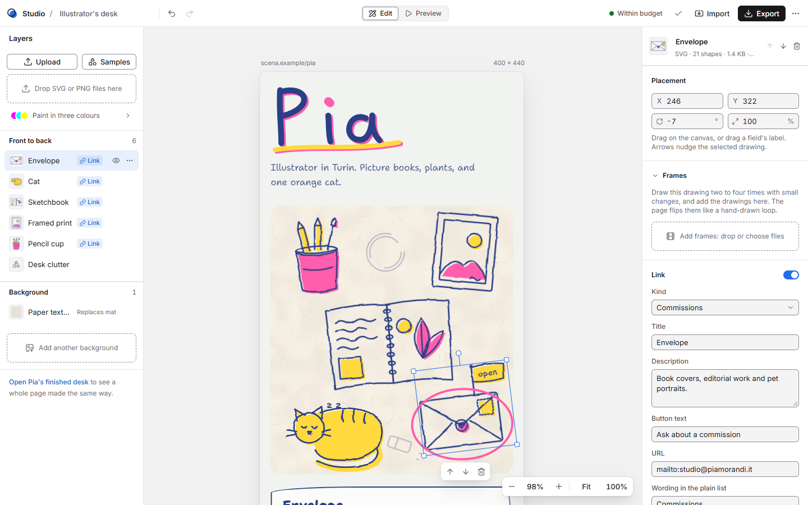
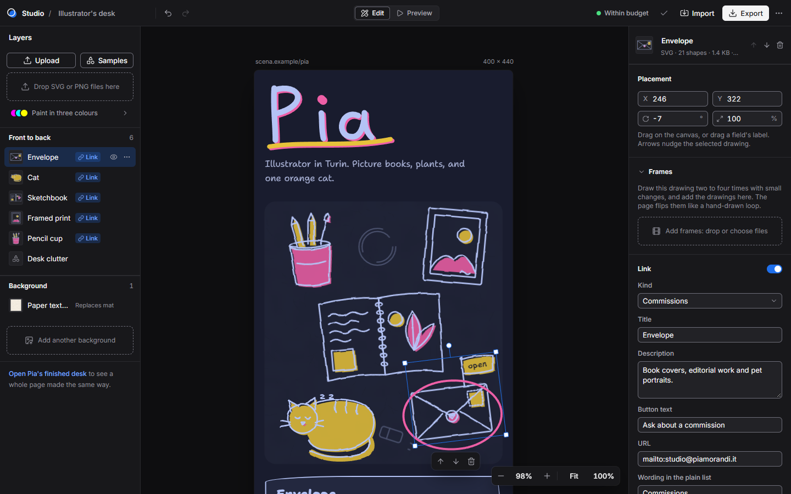
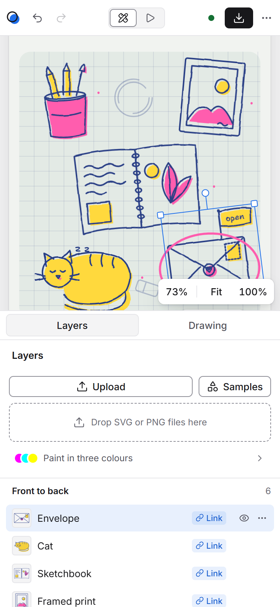

# Scena (working name)

[](https://github.com/ChronosSF/scena/actions/workflows/ci.yml)

An illustrated link-in-bio. Instead of a list of buttons, a person's page is a drawing: tap the
sketchbook for the portfolio, the envelope for commissions, the cat for the newsletter. The
platform adds the life to any drawing: hand-drawn line boil, a lift on hover, a ring that draws
itself, a reveal panel, a plain-text list for screen readers, light and dark mode, and reduced
motion.

This repository holds the scene format, the renderer that turns a scene and a page into one
self-contained HTML file, and the **studio**: an illustrator drops in their own drawings (SVG,
or PNG from Procreate), marks which ones are clickable, attaches links, and exports the page.
The product plan is in [docs/development-plan.md](docs/development-plan.md); the work it describes is
tracked as [milestones and issues on GitHub](https://github.com/ChronosSF/scena/milestones).

## Stack

- TypeScript end to end in a pnpm workspace; Node 24 runs the scripts directly.
- `@scena/scene`, `@scena/renderer` and `@scena/scenes` are pure TypeScript packages, used as source with no build step.
- The page runtime is compiled by esbuild and inlined with a CSP hash; it is under 3 KB.
- The studio is React 19 on Vite 8, built into one HTML file that opens from disk. Its interface
  uses headless Radix primitives (menus, popovers, tooltips) and Lucide icons, styled by hand;
  the design system is in [docs/design/studio-ui.md](docs/design/studio-ui.md).
- Vitest for tests, `tsc` 7 for type checks, headless Chrome over CDP for end-to-end checks.

Why this and not the plan's full stack yet: [docs/adr/0001-tech-stack.md](docs/adr/0001-tech-stack.md).

## Commands

Needs Node 24 or later and pnpm 10 (`corepack enable` gets the pinned pnpm).

```sh
pnpm install
pnpm dev          # the studio with hot reload at http://localhost:5173 (and /demo-desk.html)
pnpm build        # apps/studio/dist/index.html (the studio), dist/demo-desk.html and dist/demo-frames.html, all self-contained
pnpm preview      # serve the build at http://localhost:4173
pnpm test         # 79 tests: renderer snapshots and parity, scene model, lint and safety patterns, studio editing operations, file sniffing, frames, board and lettering
pnpm typecheck    # every package, the page runtime, the scripts and the tools
pnpm check        # typecheck + test + build

pnpm lint:scene packages/scenes/desk.scene.json packages/scenes/pia.page.json
```

Other tools, all optional:

| Command | What it does |
|---|---|
| `pnpm gen` | Rebuilds the page runtime into `packages/renderer/src/runtime.generated.ts` (dev, build, test and typecheck run it first) |
| `pnpm encode:desk` | Regenerates `desk.scene.json` and `pia.page.json` from the hand-encoding of the original prototype |
| `pnpm encode:samples` | Regenerates `samples.json`: the frame-animated steaming mug sample |
| `pnpm fixtures` | Regenerates the test drawings in `fixtures/`, including the mug's three SVG frames, a blinking face as a PNG sequence and as an animated PNG, a paper texture, a drawn desk top and a lettered "Pia" (SVG and PNG) |
| `pnpm parity` | Confirms the renderer reproduces the prototype's `demo-desk.html` (apart from the runtime) |
| `pnpm verify:studio [url]` | Drives the studio in headless Chrome through real mouse, keyboard and file-chooser input. Default target: the build from file://. Run `pnpm build` first |
| `pnpm verify:runtime` | Checks every branch of the boil control (lite mode, slow device, Save-Data, reduced motion, offscreen, hidden, idle) on the built demo page, and that frames flip, hold frame 1 and pause with it on `demo-frames.html` |
| `pnpm shots [url]` | Retakes the studio screenshots in `docs/design/` (desktop light and dark, 375 px). Default target: the build from file:// |
| `pnpm measure [--soft]` | Boil frame cost at 375×812 @3x with 1×, 4× and 6× CPU slowdown, against the original prototype; then the desk with three objects flipping frames at 6 fps |

The Chrome-based tools use the installed Chrome or Edge (or set `CHROME_PATH`). They write
screenshots and exports to `tools/out/`, which git ignores.

## Layout

```
packages/
  scene/       SceneDocument and PageDocument types, validateScene / validatePage / migrate, lintScene
  renderer/    renderPage, renderParts, CSS, geometry, escaping; runtime/ is the page script
  scenes/      desk.scene.json, pia.page.json and samples.json (the steaming mug), and their encoders
apps/
  studio/      the editor (React + Vite); src/ingest/ has the SVG sanitiser and the PNG pipeline
fixtures/      test drawings; reference/ has the original prototype and its rendered output
tools/         lint CLI, fixture generator, parity and headless-Chrome checks
docs/          development plan, architecture decisions, and design/ (the studio's design system)
```

## Pitching it

Open `apps/studio/dist/index.html` with a double-click (Chrome, Edge, Safari or Firefox). Internet
is needed only for the web fonts (Inter for the studio, Shantell Sans for the page); offline, the
studio falls back to the system font. `apps/studio/dist/demo-desk.html` is Pia Morandi's
page rendered from the scene files; `demo-frames.html` adds the steaming mug, a three-frame
animation, as a tip link. An exported page is a single HTML file and also opens directly
on a phone. To show the studio on a phone, host `apps/studio/dist/` on any static host, or run
`pnpm dev --host` and open the network address it prints.

Before you pitch, check two things:

1. **Line boil and the OS animation setting.** If Windows "Animation effects" is off (or macOS
   "Reduce motion" is on), browsers report reduced motion and the boil correctly holds still. The
   studio says so on the canvas and offers an "Animate" switch (canvas and preview only, never an
   exported page). `demo-desk.html` has no override, so change the OS setting before demoing it.
2. **Start clean.** The studio autosaves to the browser. "Start over…" in the top bar's overflow
   menu, then "Empty canvas", resets between demos. Undo covers mistakes.

The preview takes two to four seconds to paint the first time (web font plus the inlined PNG).

### Three-minute demo script

- **0:00** On the phone, open `demo-desk.html`. "This is a link-in-bio page. Tap the cat." It wakes
  up and purrs, and the card shows the newsletter. Tap the envelope: "Open for commissions ·
  Booking for spring 2027." Scroll down: "There is a plain list for screen readers and people in a
  hurry."
- **0:30** On the laptop, the studio shows an empty canvas: "Add your first drawing". Drop
  `fixtures/plant-procreate.png`, or a friend's own PNG. "Procreate exports the whole canvas; we
  trim it to the drawing." The lines start to boil.
- **0:55** Drop `fixtures/teapot-sentinel.svg`. Open "Paint in three colours" under the drop
  zone: "Paint with these three and we recolour to any palette." The coloured fills sit slightly off-register, like a riso
  print.
- **1:15** Drag, resize and rotate the plant. Turn on Link in the inspector, then type a title and URL.
  The ring draws on and the card below updates as you type.
- **1:45** Samples, then Envelope, then turn on Link. It becomes Commissions
  and a hand-drawn "open" flag appears. Switch the status to Waitlist and the flag turns pink.
- **2:10** Click the empty workspace to see the page settings, then the violet/lime palette:
  everything recolours. Switch to Dark: the PNG gets a paper sticker so its dark lines still read.
  Point at "Within budget" in the top bar, and open it.
- **2:20** Drop `fixtures/steam-mug-1.svg`, `-2` and `-3` together and choose "One drawing with
  3 frames": the mug steams. "Draw it three times; we flip the drawings, like a flipbook." Click
  frame 2 to see the onion skin, then set it to "Once on tap".
- **2:25** Drop `fixtures/paper-texture.png` on "Add a background": it replaces the cutting mat,
  clipped to its shape. Then, in the page settings, drop `fixtures/pia-lettering.svg` on "Name
  lettering": her name is drawn, in the palette's ink with a riso shadow, and screen readers
  still hear the typed name. Try a typeface: Caveat.
- **2:30** Preview, phone frame: "This is the exact file we publish." Tap the plant, then the mug.
- **2:45** Export: one HTML file of about 20 KB with no outside scripts. Then "Open Pia's finished
  desk": "Her whole page is the same format your drawings just became."

## Studio design

The canvas keeps the page's riso look; the tool around it is neutral, with one blue accent for
selection and focus, Inter, a 4 px grid and light and dark chrome that follows the OS. Tokens,
contrast, layout and the reasoning are in [docs/design/studio-ui.md](docs/design/studio-ui.md).

| Desktop, light | Desktop, dark | Phone |
|---|---|---|
|  |  |  |

## Numbers (measured 9 November 2026, this build)

| Item | Result | Budget in the plan |
|---|---|---|
| Page runtime | 3.1 KB minified, 1.5 KB gzipped | 5 KB |
| `demo-desk.html` | 23.6 KB raw, 7.3 KB gzipped | 60 KB gzipped |
| `demo-frames.html` (the desk plus the steaming mug, three frames) | 27.1 KB raw, 8.0 KB gzipped | 60 KB gzipped |
| Pia's desk with a paper-texture background and her lettered name, exported from the studio | 31.0 KB raw, 12.8 KB gzipped | 60 KB gzipped |
| Studio build (`dist/index.html`, React and Radix included) | 570 KB raw, 178 KB gzipped | — |
| Frames: three objects flipping at 6 fps on top of the boil, 1× to 6× CPU | 8 to 30 ms of main thread per second; boil frames unchanged at 16.7 ms ([ADR 0002](docs/adr/0002-frame-animation.md)) | < 16 ms main-thread per frame |
| Desk lint | 113 of 400 shapes, 5 of 8 clickable, 20 of 24 assets, worst contrast 5.2:1 | 4.5:1 |
| Boil frame cost, headless Chrome, 375×812 at 3×, software rendering, 1× to 6× CPU slowdown | 16.6–16.7 ms per frame; drawing work 9–10 ms per seed change with per-object filters (11–14 ms with the prototype's single filter) | < 16 ms main-thread per frame |

Not measured on a real phone yet. Chrome's CPU throttling slows only the main thread, so it
understates a budget Android.

## Not built yet

On purpose, for the pitch: accounts, publishing, analytics, billing and custom domains (see the
plan); the Open Graph image; the badge control in the studio (the renderer
supports it); drawing a custom tap-area shape (the format supports it); gradients painted with
the sentinel colours; `<symbol>` in uploaded SVG; and, for frame animation, motion presets (float,
sway, blink), path motion and Lottie- or Rive-style runtimes, which are out of scope. Touch input uses pointer events, but only
mouse input has been automated.

## Format notes beyond the plan

Small, optional additions the build needed:

- ids (scene, palette, asset, slot and layer) use only letters, digits, `-` and `_`, 64 characters at
  most, because they are written into attributes, selectors and `url(#...)` references;
- a `procedural` asset kind for the mat, grid and dot paper;
- multi-part decoration layers;
- `name` on layers, `bbox` on assets and `name` on palettes;
- a `listLabel` per link (the prototype's list says "Portfolio" while its panel says "Sketchbook");
- `copy.hint` and `copy.sceneLabel`;
- art classes `ink`, `stroke-*`, `art-text` and `on-accent` alongside `role-*`;
- frame-flip animation on parts: `frames`, `fps`, `play`, `boil`, and `crop` on raster assets
  ([ADR 0002](docs/adr/0002-frame-animation.md));
- `fit`, `clip` and `assetDark` on background layers, a curated `theme.font` (validated against
  `TYPEFACES`), `editable.font`, and `header.lettering` for a hand-lettered name
  ([ADR 0003](docs/adr/0003-board-type-lettering.md)).

Scale is applied to a drawing's parts rather than its group, so rings, misregistration and boil
stay in canvas units at any size. The types live in `packages/scene/src/types.ts`.

## License

All rights reserved. See [LICENSE](LICENSE).
