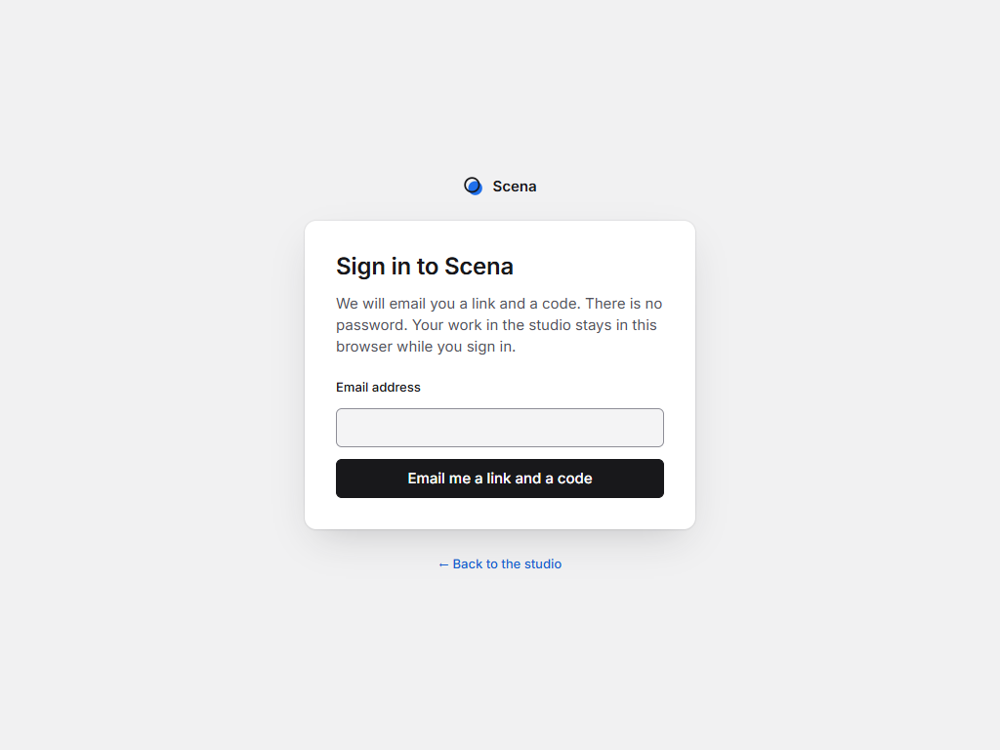
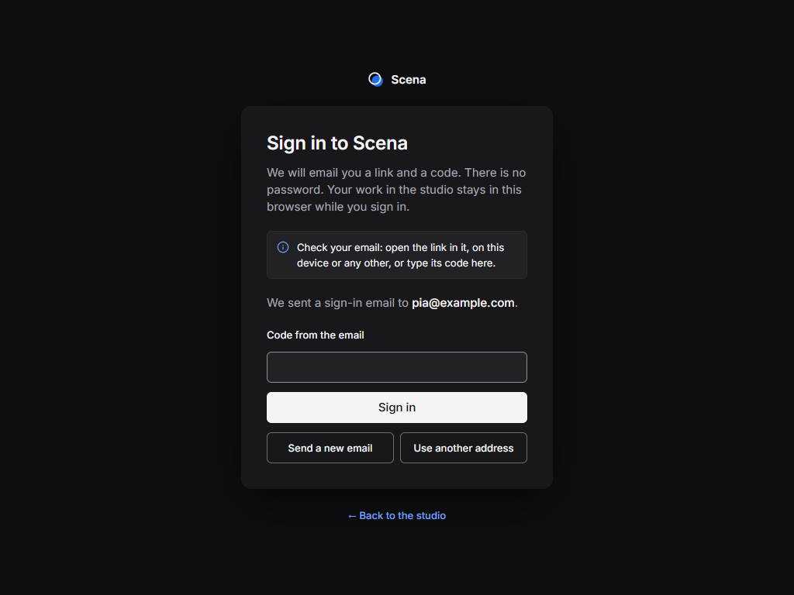
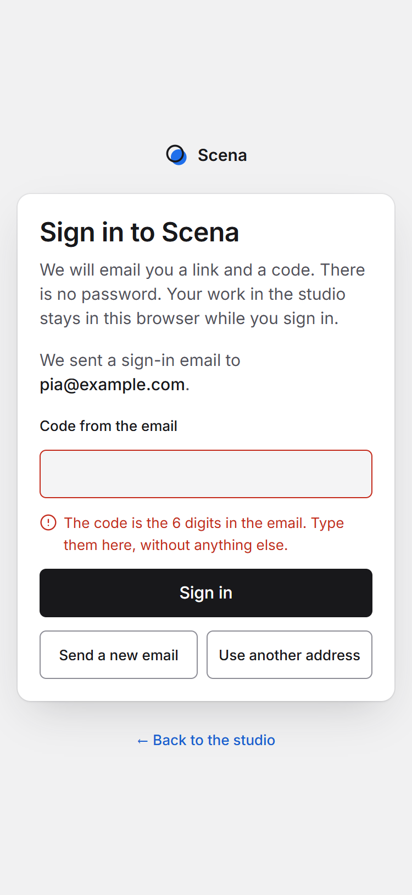

# App pages

The web app's own pages (sign-in at both of its steps, the confirm page behind the email's link,
`/admin`, the home placeholder, and "Page not found") are drawn with the studio's design system
([studio-ui.md](studio-ui.md)): its tokens, its type and its controls, at a roomier scale for
pages a person reads and fills in. The pages to come (the dashboard, billing, the legal pages)
start from here. [ADR 0009](../adr/0009-one-theme.md) records why there is one theme and no
second styling system.

Principles:

- **One theme.** The tokens, the base and the controls the studio and the pages share are in
  `packages/studio/src/theme.css` (`@scena/studio/theme.css`). The web app's root layout loads
  it, and Inter, for every page; the studio's stylesheet imports it. A stylesheet of the web app
  holds layout and tokens, never a colour, a font stack or a radius of its own.
- **The same look as the studio's chrome.** Inter with `cv11` and `ss01`, `--ui-workspace`
  behind the page, text in `--ui-text`, `--ui-text-2` and `--ui-text-3`, hairlines in
  `--ui-line`, control borders in `--ui-control`, and the accent focus ring. Dark follows the OS.
- **Ink for the primary action, blue for focus and links.** The primary button is the studio's
  `btn btn-primary`; a secondary one is its outline `btn`. Links are `--ui-accent-text`.
- **Said with an icon as well as colour**, as the studio's field messages are.
- **The words stay the words.** A change of look never changes what a page says.

The screenshots come from `pnpm shots`, from the web app's build with the local stack's sign-in:
the email step in light, the code step as it arrives in dark, and a code of the wrong shape on
a phone.

## The page scale

Inside `.page-scale` (theme.css) the studio's controls are the same rules at a larger size. The
scope sets the control height and the base type, and steps labels and field messages up one size:

| | The studio (the tool) | The page scale |
|---|---|---|
| Controls | `--ui-h-control`, 28 px | `--ui-h-page`, 40 px; 44 px on a phone or a touch screen |
| Text | `--ui-md`, 13 / 20 | `--ui-lg`, 15 / 22 |
| Titles | `--ui-lg` at 600 (dialogs) | `--ui-xl`, 24 / 30 at 600 |
| Field labels | `--ui-sm` at 500 in `--ui-text-2` | `--ui-md` at 500 in `--ui-text` |
| Field messages | `--ui-sm`, 14 px icon | `--ui-md`, 16 px icon |
| A field's inner padding | 8 px | 12 px |

On a phone or a touch screen a field's type is 16 px, under which iOS zooms into the field; a
field with a larger size of its own (the code, at 20 px) keeps it.

## The shell

`Shell` (`apps/web/app/_ui/Shell.tsx`) frames every one of these pages:

- the product mark and "Scena", above one card in the middle of the window;
- the card: `--ui-panel`, radius `--ui-r-xl` (12, the dialogs'), `--ui-shadow-page`, 400 px at
  most, 32 px inside and 20 px between its parts; on a phone (480 px and under), 20 px inside
  and 16 between, with 16 px gutters;
- in the card, the title (`--ui-xl`), the lead in `--ui-text-2` close under it, then the page's
  content: a form at 12 px between its parts, full-width buttons, two buttons side by side a
  step smaller (one above the other where they do not fit), "or" between two ways in, and a
  closing note in `--ui-text-3`;
- under the card, where a page has one, the way back: a link in `--ui-accent-text` with an
  arrow. It comes after the card in the tab order too, as it is seen.

## What is said

- **News and problems** go in one block: `--ui-field` behind, a `--ui-line` border, radius 6,
  13 / 20 text in `--ui-text`, and an icon: the information circle in `--ui-accent-text` for
  news, the alert circle in `--ui-danger` for a problem. It sits in a live region that is in the
  page from the start (`Message`), and takes no room while it is empty.
- **A problem with one field** is shown under that field in the studio's field-message style
  (`field-msg error`, the alert icon), and the field's border turns `--ui-danger`
  (`aria-invalid`). The live region still says the sentence, unseen, once; the field's
  `aria-describedby` points to it.

## Contrast

These pages add three pairs to the studio's table (in [studio-ui.md](studio-ui.md)):

| Pair | Light | Dark |
|---|---|---|
| accent-text on workspace (the way back) | 5.2 | 8.0 |
| accent-text on field (the news icon) | 5.3 | 6.6 |
| danger on field (the problem icon) | 5.2 | 5.7 |

Every other pair on them is one the studio already measures: text, text-2 and text-3 on the
panel, text on the field, danger on the panel (a field's problem, and its border as a control
boundary), on-ink on ink, the control border on the panel, and the focus ring on the panel and
the workspace.

## Decisions we are least sure of

1. **44 px controls on a phone.** The approved design has 40 px controls everywhere. A phone
   gets 44, the touch target the sign-in checks already held the email field to; the rest of
   the page is as drawn.
2. **One icon for all news.** The design draws an envelope beside "Check your email"; the news
   block uses the information circle for every piece of news, since the same block also says
   "You have signed out".
3. **The home placeholder says "Scena" twice**, above the card and as its title, because it
   keeps its words and takes the same shell. It goes when the dashboard replaces it.
