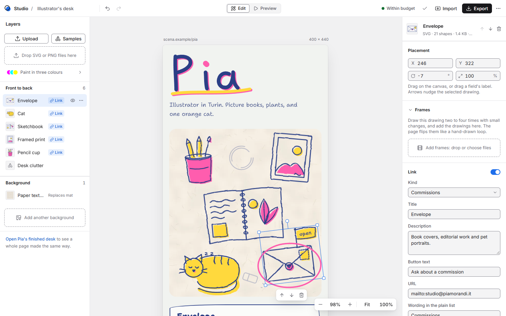
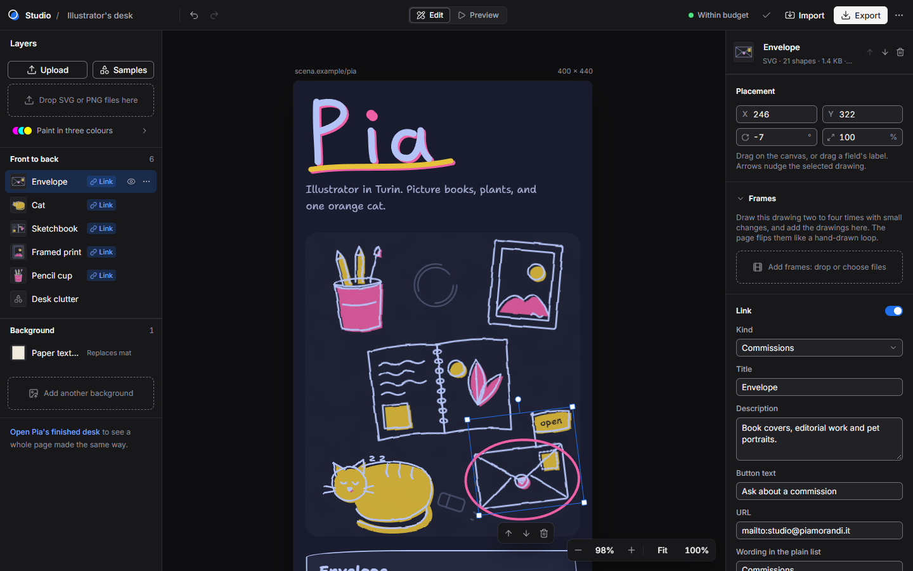
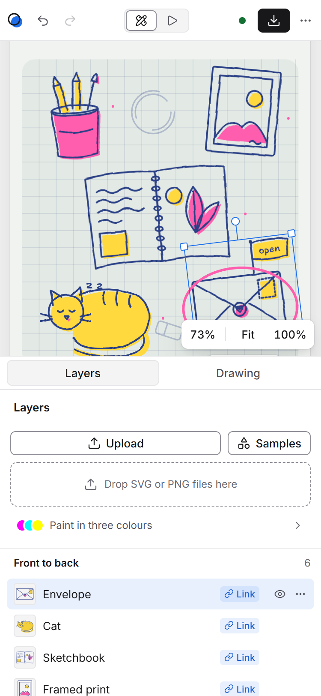
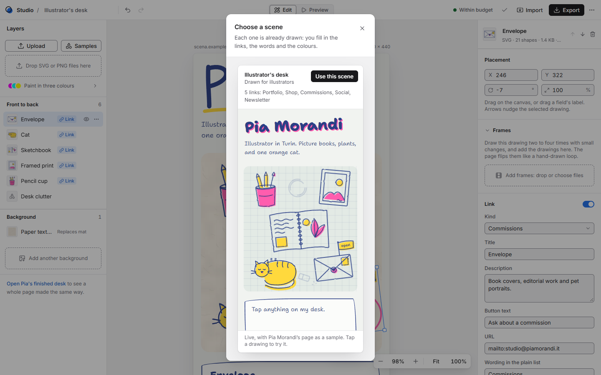

# Studio UI

The studio is a tool around a canvas. The canvas is the user's page, live: header, mat, drawings,
reveal panel and plain list, drawn by the published renderer in the page's riso style (Shantell
Sans, wobbly borders, two-colour palettes). Everything around it is the tool, and it has its own
quiet design so the page carries all the colour and personality.

Principles:

- **Neutral chrome, one accent.** Greys do the structure; a single blue marks selection, focus
  and "on". Primary actions are ink (near-black, or near-white in dark mode), not blue, so the
  accent never competes with the page.
- **Precise, not decorative.** 1 px hairlines, a 4 px grid, three radii, shadows only on things
  that float.
- **The page is never restyled.** Chrome tokens are `--ui-*`; page tokens (`--paper`, `--line`,
  `--accent1` and so on) belong to the renderer and stay inside `.stage`. Shantell Sans never
  appears outside the canvas.





The screenshots come from `pnpm shots` (headless Chrome, Pia's desk with the envelope selected;
then the scene picker over it).

## Tokens

All tokens are in `packages/studio/src/theme.css` (`@scena/studio/theme.css`), with the base
and the controls (buttons, fields, field messages) the web app's own pages share; `studio.css`
imports it and adds the rest of the chrome. The web app's pages use them at a roomier scale
([app-pages.md](app-pages.md)). The chrome follows the OS light or dark setting through
`prefers-color-scheme`. The page on the canvas follows its own Light, Dark or Auto setting,
independently.

### Colour

| Token | Light | Dark | Use |
|---|---|---|---|
| `--ui-workspace` | `#F1F1F2` | `#0E0E10` | the area the page floats in |
| `--ui-panel` | `#FFFFFF` | `#18181B` | bar, panels, menus, dialogs |
| `--ui-field` | `#F4F4F5` | `#222226` | text fields, segmented tracks, thumbnails |
| `--ui-line` | `#E6E6E9` | `#2A2A2F` | 1 px hairlines between regions |
| `--ui-control` | `#8E8E97` | `#6E6E79` | borders of interactive controls (3:1 against the panel) |
| `--ui-control-hover` | `#6B6B74` | `#8E8E98` | the same, hovered |
| `--ui-hover`, `--ui-pressed` | ink at 5%, 9% | white at 6%, 10% | row and button states |
| `--ui-text` | `#18181B` | `#F4F4F5` | primary text |
| `--ui-text-2` | `#52525B` | `#A8A8B2` | labels, secondary text |
| `--ui-text-3` | `#6B6B74` | `#8E8E98` | hints, counts, meta |
| `--ui-ink`, `--ui-on-ink` | `#18181B`, `#FFFFFF` | `#F4F4F5`, `#18181B` | primary buttons, the toast |
| `--ui-accent` | `#1F6FEB` | `#1F6FEB` | selection handles, focus ring, switches when on, the selected palette |
| `--ui-accent-text` | `#1A5FD0` | `#78A6FF` | the accent used as text (links, the Link badge) |
| `--ui-accent-soft` | accent at 10% | accent at 22% | selected layer row, badge and drop target fills |
| `--ui-ok`, `--ui-warn`, `--ui-danger` | `#157034`, `#9A4A06`, `#C42B1C` | `#4ADE80`, `#FBBF24`, `#F87171` | budget status, field messages, destructive items |

Why this blue: the page palettes are riso pairs (fluo pink, yellow, lime, teal, violet, orange)
on cream or navy. A clean, slightly cool blue, close to the system selection colour designers
already read as "selected", is the one hue none of them use, so a handle is never mistaken for
art. It keeps at least 3:1 against both workspaces and against the page paper colours (see
below), so the 1 px handles stay visible on any palette.

### Contrast (WCAG 2.2 AA)

Text needs 4.5:1. Control boundaries, focus indicators and icons need 3:1. Measured:

| Pair | Light | Dark |
|---|---|---|
| text on panel, workspace, field | 17.7, 15.7, 16.1 | 16.1, 17.5, 14.4 |
| text-2 on panel, field | 7.7, 7.0 | 7.5, 6.7 |
| text-3 on panel, field, workspace | 5.3, 4.8, 4.7 | 5.5, 4.9, 5.9 |
| accent-text on panel, on accent-soft | 5.9, 5.1 | 7.3, 5.9 |
| text on a selected row (accent-soft) | 15.6 | 12.9 |
| white on accent (switch knob) | 4.6 | 4.6 |
| on-ink on ink (primary button, toast) | 17.7 | 16.1 |
| ok, warn, danger on panel | 6.2, 6.3, 5.7 | 10.2, 10.6, 6.4 |
| control border on panel (non-text) | 3.3 | 3.5 |
| focus ring (accent) on panel, workspace | 4.6, 4.1 | 3.8, 4.2 |
| danger icon in the toast | 9.3 | 5.2 |
| accent-text on workspace (the app pages' way back) | 5.2 | 8.0 |
| accent-text, danger on field (the app pages' message icons) | 5.3, 5.2 | 6.6, 5.7 |

Disabled controls (Undo with nothing to undo, a menu item that cannot apply) are exempt and drawn
faded, at 35% to 45% opacity. The accent also keeps 3.2:1 or more against every page paper and
mat colour in all five palettes, light and dark, so the handles read on any page.

### Type

Inter (400, 500, 600) from Google Fonts, with `cv11` and `ss01` for the single-storey a and open
digits, falling back to the system UI stack offline. Numbers in fields and readouts use tabular
figures.

| Token | Size / line height | Use |
|---|---|---|
| `--ui-xs` | 11 / 16 | badges, menu labels, the frame label |
| `--ui-sm` | 12 / 16 | hints, meta, counts, the budget pill |
| `--ui-md` | 13 / 20 | the base: controls, fields, rows; section titles at 600 |
| `--ui-lg` | 15 / 22 | dialog and empty-state titles, at 600 |
| `--ui-xl` | 24 / 30 | page titles on the app's own pages, at 600 (the page scale) |

Weights: 400 for text, 500 for controls and labels that need weight, 600 for titles. No other sizes.

### Space, lines, radii, elevation

- Spacing is a 4 px scale: `--ui-1` 4, `--ui-2` 8, `--ui-3` 12, `--ui-4` 16, `--ui-5` 20,
  `--ui-6` 24, `--ui-8` 32. Panels are inset 16 px, rows 8 px.
- Lines: 1 px `--ui-line` between regions, 1 px `--ui-control` around controls.
- Radii: 4 (badges, thumbnails, knobs), 6 (controls, rows), 8 (cards, menus, popovers, the page).
  Dialogs use 12 (`--ui-r-xl`), as does the card of the app's own pages; the phone frame uses its
  own device radius.
- Controls are 28 px high (`--ui-h-control`), and 40 px at the app pages' scale (`--ui-h-page`);
  the bar is 48 px; the Layers panel is 256 px and the Inspector 296 px.
- Shadows only on floating surfaces: `--ui-shadow-pop` for menus, popovers, the toast, the zoom
  control and the selection toolbar, and `--ui-shadow-page` for the page and the device frame.

### Icons

[Lucide](https://lucide.dev) through `lucide-react` 1.70.0, stroke 1.75, 16 px in controls and
14 px in dense places. An icon always sits next to a visible label, or carries an `aria-label`
and a tooltip. The product mark is two offset circles, an outline and an accent fill, a nod to
riso misregistration.

### Motion

`--ui-ease` is `cubic-bezier(0.2, 0, 0, 1)`, a quick ease-out. `--ui-fast` (120 ms) is for hover
and press, `--ui-base` (160 ms) for menus, popovers, dialogs and the toast. Nothing in the chrome
moves on its own. With reduced motion, every chrome transition drops to 1 ms.

The page's own boil is separate: it follows the page's Motion setting and the OS. When the OS
reduces motion, the studio shows an "Animate" switch on the canvas; it applies to the canvas and
the preview only, never to the export.

## Layout

```
+---------------------------------- bar, 48 -----------------------------------+
| (o) Studio / Scene name  undo redo | [Edit|Preview] | * Within budget  ok  Import  [Export]  ... |
+-----------+-----------------------------------------------+------------------+
| Layers    | workspace                                     | Inspector        |
| 256       |   scena.example/pia               400 x 440   | 296              |
| Upload    |   +-------------------+                       | Placement        |
| Samples   |   |  the page (live)  |                       | Link             |
| drop zone |   +-------------------+                       | Commissions      |
| colours   |                     [- 100% + | Fit 100%]     | Tap area         |
| rows      |                                               | (or the Page)    |
+-----------+-----------------------------------------------+------------------+
```

- **Top bar.** The product mark and "Studio", then the scene name as an inline text field, then
  Undo and Redo. Edit/Preview is a segmented control in the exact centre; in Preview it gains the
  device (phone or full width) and page-appearance controls, on a wide screen only. On the right:
  - the budget pill, a status dot and a summary that opens the checks in a popover;
  - the autosave indicator, a quiet check, or a warning when the work is too big for browser
    storage. In the web app, for a signed-in person, it says where the work is in words from
    the app ("Saving…", "Saved", "Offline, retrying", "Changed elsewhere", "Saved in this
    browser"), beside a cloud with a check, a cloud with an arrow or a warning; the words show
    from 1180 px, the icon at every width, phones included, and the whole sentence is its
    tooltip. "Saving…" and "Saved" keep each other's room, so the bar does not move at every
    save, and are not read out; the warnings are, through the studio's live region
    ([ADR 0007](../adr/0007-server-autosave.md));
  - Import, and Export (the one primary button);
  - an overflow menu with Import, "Choose a ready-made scene…" (the scene picker), "Open Pia's
    finished desk" and "Start over…". When saved work
    could not be opened it also has "Saved work that did not open…": a dialog that gives the
    reasons, offers the work as files in the export dialog's rows, and can discard it. The same
    dialog opens by itself once, on the load where the work was set aside. In the web app it
    also opens when a signed-in person's account had another version of the page, which opened
    in place of the work in the browser; its first sentence then says so.
- **Layers.** Upload, a Samples menu with thumbnails of Pia's sketches, and a dashed drop target.
  Under them, "Paint in three colours" shows the three sentinel swatches as a compact row; it
  opens a popover that maps each swatch to the palette colour it becomes.

  The rows run front to back. Each has a thumbnail rendered by the page renderer, the name, a
  frames badge with the frame count for animated drawings, a Link badge for clickable drawings,
  and, on hover or selection, a visibility toggle and a menu (forward, back, "Use as
  background", "Use as name lettering", delete). Rows reorder by dragging; the pointer is
  captured only after 5 px, so clicks still select. On the keyboard, Alt+Up and Alt+Down reorder,
  Up and Down move between rows, and Delete removes.

  Under the drawings, a **Background** group ([ADR 0003](../adr/0003-board-type-lettering.md))
  lists uploaded backgrounds apart, since they sit under every drawing and do not reorder with
  them. Each row shows "Replaces mat" or "Over mat" and has a menu with "Use as drawing" and
  Delete. The group ends in a dashed "Add a background" target (choose or drop a paper, a scan,
  a drawn desk), and the whole group accepts dropped files. The Samples menu has a "Backgrounds"
  part with the drawn desk top.
- **Workspace.** A neutral surface with the page floating at fit-to-width. On a desktop, Fit also
  keeps the header and the drawing in view, and never goes above 100%, so PNGs stay sharp.
  - A frame label shows the address and the canvas size.
  - The zoom control (minus, readout, plus, Fit, 100%) floats bottom right.
  - Ctrl or Cmd with the wheel, or a pinch, zooms. Shift+1 fits and Shift+0 is 100%.
  - Pressing the empty workspace clears the selection.
- **Selection.** A 1 px accent box with four square corner knobs (resize about the centre) and a
  round knob on a stalk (rotate). The handles stay the same size on screen at any zoom, and so do
  their hit areas: 40 px across, as before the redesign. A small upright toolbar (forward, back,
  delete) floats under the rotated box.
- **Inspector, drawing selected.**
  - A header: thumbnail, name, what the drawing is, order and delete.
  - Placement: X, Y, rotation and size as numeric fields. Drag a field's icon or letter to scrub.
  - Frames (see below).
  - Link: a switch makes the drawing clickable. Then kind, title, description, button text, URL
    with inline validation, and the wording in the plain list.
  - Commissions: status and note, for commission links.
  - Tap area.
  - Use as: "Background" and "Name lettering" buttons.
- **Inspector, background selected.**
  - A header: thumbnail, name, and what it is ("Background · WebP · 600×660 · 5 KB").
  - Background:
    - Placement, a segmented control: Replace the mat, Over the mat.
    - Fit, a segmented control: Cover, Contain.
    - "Clip to the mat's shape", a switch.
  - Dark mode: a dark variant with its own drop target and Remove. Without a variant, one line
    says what happens: a raster is multiplied onto the dark mat; a sentinel-painted SVG
    recolours.
  - "Use as drawing".
  - Backgrounds get no handles on the canvas; they are set here.
- **Inspector, nothing selected.** The Page:
  - Profile.
  - Name lettering: a drop target, then a preview on a field-coloured card, the file row with
    Remove, a width slider and a "Tilt like the typed name" switch.
  - Typeface: six cards in a radio group. Each card shows the page's name in that face, at its
    name size, with the face and a two-word note under it. The chosen one gets the accent
    outline, like a palette chip.
  - Palette swatches, light or dark, motion, canvas surface and size, the words around the
    drawing, and the keyboard shortcuts.
- **Empty state.** A card centred on the empty mat: "Add your first drawing", with Upload and Add
  a sample, and under them one quiet line for the other way to a page: "Choose a ready-made
  scene", which opens the scene picker. It is chrome, so it sits outside the page's CSS and does
  not scale with the zoom.
- **Scene picker** (the plan's section 2.2). A dialog, "Choose a scene", with one card per
  ready-made scene. It is as wide as its cards, up to three in a row; on a phone it takes the
  whole screen, one card to a row.

  

  - A card's head has the scene's name, who it was drawn for ("Drawn for illustrators", from
    the scene's `audience`), and the one primary button, "Use this scene".
  - Under it, what the scene has room for, in plain words: "5 links: Portfolio, Shop,
    Commissions, Social, Newsletter". The words are the slots' kinds, in the order of the plain
    list; a slot of the kind "custom" is listed by its label. The card of the scene that is
    open says "Open now".
  - Then the scene itself, not a picture of it: the published page with the scene's sample
    content, in a sandboxed frame, as in Preview. The lines boil, and a tap on a drawing opens
    its panel; links say where they would go instead of leaving. The frame is a phone's screen
    (375 × 667) scaled to the card, so the panel a tap opens is in view under the drawing.
    On a narrow screen, where the cards are one to a row, the page in the frame does not scroll:
    a swipe that starts on it moves the list of cards.
    Until the page paints, the frame is the colour of the page's paper.
  - Choosing a card opens the scene in the links-only mode, in Edit, with a new page made from
    the scene's own wording, and closes the picker. If there is work on the canvas it asks
    first (see "Opening another scene"); the picker stays open behind the question.
  - Keyboard. The heading takes the focus when the picker opens, not the first button, so a
    key held on the way in cannot choose a scene. Tab goes to Close, then through each card:
    its button first, then the page in its frame, drawing by drawing. Escape, Close or a press
    outside closes it, and the focus returns to where the picker was opened from.
  - The cards come from a list (`BUILT_IN_SCENES` in `@scena/scenes`); the picker names no
    scene. The README's "Adding a ready-made scene" says which files a new one touches.
- **Links-only mode** (a scene with `license: "builtin"`; the plan's phase 1). The scene is
  filled in, not designed, so the tool takes away everything that changes a drawing and keeps
  the same places for what is left:
  - The left panel is **Links**, with a "Ready-made" badge: the scene's slots in the order of
    the plain list, each with its drawing's thumbnail, the eye toggle where the scene lets the
    link be turned off, and a short note for what is still to do ("No address", "Off"). No
    upload, samples, reordering or delete.
  - The canvas is drawn as the published page, not as an editor canvas: the tap areas are the
    real ones and decorations cannot be picked. A press or Enter on an object selects it, and
    the page's own ring and panel show the selection. There are no handles and no toolbar, and
    the keys that move, turn, resize, delete or reorder do nothing. A dropped file is refused
    with a toast that says why. On a phone a swipe that starts on the drawing scrolls the page.
  - The inspector with an object selected is the **link's form**: the slot's label and kind as
    a heading (not a field), an on/off switch in the section head, then title, description,
    button text, URL and the plain-list wording, and the commission status and note where the
    slot has them. With nothing selected it is the Page without Lettering, Typeface, Canvas and
    Keyboard, with the palettes the scene offers, and a closing "Scene" note that says whose
    drawing it is and what can be changed.
  - The scene name in the bar is text, not a field.
  - On a phone the tabs read Links, and Link or Page, and a link's row opens its form.

  The mode is entered by choosing a scene in the scene picker. The scene opens with a new page
  made from its slots' own wording, not the sample page the picker showed it with.
- **Fields the page depends on.** A link needs a title, a page needs a name, and an address
  has to be one. Each of these fields keeps what was typed and says what is wrong under it,
  while the document holds something valid: the last title or name, or no address at all (a
  link never keeps pointing at an address that is being replaced). A link that comes back on
  without a title takes its slot's.
- **Saving.** Autosave checks the documents first. Work that would not open again is not
  written over work that does: the indicator in the bar turns to a warning that says so, and the
  last saved work stays. Work saved under older rules is brought in line when it is opened, so
  it is not turned away for something the studio itself allowed.
- **Opening another scene.** A scene chosen in the picker and "Open Pia's finished desk"
  replace what is on the canvas, so when there is work there (a drawing, a background,
  lettering, or words typed on the page) a small dialog asks first, with Cancel and "Open it".
  On an empty, untouched canvas they open at once. The drawings of a ready-made scene are not
  the user's work: with nothing typed on its page, going on to another scene asks nothing, so
  scenes can be tried one after another. Links typed on one scene are not carried to the next.
- **Frames** ([ADR 0002](../adr/0002-frame-animation.md)). A collapsible section under Placement.
  - Before a drawing has frames, the section shows one line of explanation and a dashed "Add
    frames" target. Choose files, or drop them on the section.
  - With frames, it shows a strip of 52 px frame thumbnails, numbered, ending in a dashed add
    tile that is also a drop target.
  - Clicking a frame holds the canvas on it. While the section is open, the other frames show
    at 20% behind it (the onion skin), to check registration. The held frame gets an accent
    outline, the same as a selected palette chip.
  - On the keyboard, Left and Right choose a frame, Alt with an arrow reorders, and Delete
    removes. The strip is one tab stop.
  - A small toolbar under the strip says "Playing" or "Frame 2 of 3", with move-earlier,
    move-later and remove buttons.
  - Then: a Speed slider from 2 to 12 fps, with the readout in animators' words ("6 fps, on
    twos"); "Plays" (Always, On hover, While selected, Once on tap; decorations get Always only,
    with a hint to turn on Link); and two switches with one-line hints, "Play on the canvas" and
    "Boil the frames too".
  - A closing note gives the shared box, so the author knows the frames line up. The
    description line in the header says the same ("3 frames at 6 fps in one 72×104 box").
- **Several drawings at once.** Dropping or choosing two or more drawings of one kind opens a
  small dialog: "Add 3 drawings". It has two large choices in the style of the export rows, "One
  drawing with 3 frames" (film icon) and "3 separate drawings" (copy icon), and Cancel. An
  animated PNG or WebP skips the question: it becomes frames.
- **Preview** (the plan's section 2.3). The exact exported page runs in a sandboxed iframe, and
  the inspector stays beside it, where it is in Edit; the Layers or Links panel goes away.

  ```
  +---------------------------------- bar, 48 -----------------------------------+
  |                  [Edit|Preview] [phone|full] [appearance]          [Export]  |
  +-----------------------------------------------------------+------------------+
  | workspace                                                 | Inspector        |
  |                    +----------------+                     | 296              |
  |                    | the page, live |                     | the tapped       |
  |                    | (sandboxed)    |                     | link's form,     |
  |                    +----------------+                     | Title focused    |
  +-----------------------------------------------------------+------------------+
  ```

  - The page sits in a phone frame (375 px wide) or in a browser window with the page address.
    Taps inside it work as on the published page: the panel opens under the drawing, and a link
    says where it would go instead of leaving.
  - A tap on a drawing, or Enter or Space on it, also selects it in the studio. The inspector
    shows its link's form (the links-only mode's form, or a drawing's Link section in a scene of
    one's own), brings the Title field into view and puts the focus in it. The scroll is smooth,
    and instant with reduced motion. The same words are said in the polite live region as for a
    drawing picked on the canvas: "Envelope selected. Its link is in the panel."
  - What is typed reaches the page a moment later, and shows where it was tapped. An edit
    renders the page again and the frame reloads; after a tap, the page is rendered with that
    drawing selected, so it comes back with the same panel open and the new words in it. The
    form keeps the focus throughout. A tap alone does not reload the frame: the page is rendered
    again only when the documents change (the store's `docRev`), never for the selection. A
    change of device or of screen width puts a new frame in the document, so the page is
    rendered again for that too, with the selection as it then is. The Preview opens as a
    visitor first sees the page, with nothing selected, and forgets the tapped drawing as soon
    as the selection changes any other way.
  - The page keeps its place through those reloads. The first one after a tap brings the open
    panel into view. After that the page comes back where it was last scrolled to, by itself or
    by the person: someone who has scrolled on to the plain list to watch its wording change
    stays there. A frame keeps its name when its document is replaced, and the page notes its
    scroll position in it.
  - With a drawing selected, the inspector starts with **Page settings** (a ghost button with a
    left arrow), and the drawing's name beside it. The row stays at the top of the panel while
    the form scrolls under it, so the way back and the name of the drawing are in view after a
    tap has scrolled the form to the Title. The button clears the selection, and the panel takes
    the focus at its top, not the Name field, so a phone's keyboard does not come up for a
    change of panel. It is there in Preview at every width: on a phone the page fills its pane
    edge to edge and there are no tabs, and on a wide screen the other way, a press with the
    main button on the workspace around the page (as on the canvas), is for a pointer only.
  - How the page says which drawing was tapped. Only the Preview renders the page with
    `editorPreview`, which adds `"ed":1` to its runtime data. The runtime's code for it is one
    block behind that flag: it posts `{ type: "scena:tap", slot: "<slot id>" }` to its parent
    when a drawing is activated, and it keeps the page's place, without animation, when the page
    arrives selected. An exported page, a published page and the picker's cards post
    nothing and never scroll themselves. The frame shows documents a person supplied, so the
    studio acts on a message only when it comes from the Preview frame's own window, from the
    opaque origin such a frame has (`"null"`), in exactly that shape, and names a slot of the
    open scene that has a drawing (`tappedObject` in `src/preview-message.ts`). What it then uses
    is the scene's own slot, never the message's text.
- **Phone, below 900 px.** One column:
  - the bar, then the canvas;
  - a tab bar: Layers, and Drawing or Page;
  - the active panel as a bottom sheet, 44% of the height.

  Picking a drawing on the canvas switches to its settings; picking it in the list stays in the
  list. Fit is width-only and the page scrolls. Labels in the bar collapse to icons, which keep
  their accessible names. There is no horizontal scrolling at 375 px.

  In Preview there are no tabs. The page is pinned on top, at the screen's own width with no
  device around it, in a pane 40% of the height, and the inspector scrolls under it. The page
  scrolls inside its pane. The Device control is not shown: the screen is the phone. A tap on a
  drawing puts its Title field at the top of the form, just under the Page settings row, which
  stays in view with the drawing's name. The focus raises the on-screen keyboard, which on a
  phone covers roughly the bottom 40% of the screen, so the field and the page above it stay in
  view: on a 375 × 812 screen the field ends at about 473 px. The pane is 40% and not the 44%
  the sheet has in Edit because that row takes its height from the form. The drawing and its
  panel are usually below the pane's fold, so the first edit after a tap brings the open panel
  into view, and the page then stays where it is scrolled to rather than starting at its top.
  Page settings is the way back to the page's own settings.

## Components

Thin wrappers in `packages/studio/src/components/ui.tsx`, so every surface looks and behaves the same:

- `Button` (default outline, `primary` ink, `ghost`, `danger`) and `IconButton` (28 or 24 px,
  always with a tooltip and an accessible name).
- `Segmented`: native radios in a `radiogroup`, so the arrow keys work. The selected item is a
  raised chip in the panel colour with a control-coloured border.
- `Switch`: a native checkbox with `role="switch"`.
- `TextField`, `SelectField` and `NumberField`, with counters and inline messages. Errors and
  warnings carry an icon as well as colour. In a `NumberField`, the prefix icon or letter scrubs
  by dragging, and Enter or blur commits.
- `Menu`, `Popover` and `Tip`: Radix primitives styled with the tokens above.
- Dialogs are native `<dialog>` elements; the browser provides the focus trap, Escape and the
  backdrop.
- `FramesSection` (`components/FramesSection.tsx`) and the frames-or-separate dialog reuse
  these pieces: the drop target, the export dialog's choice rows, the switch rows, and the
  accent outline for "this one is chosen".
- The toast drops in under the bar and is visual only. The same message goes to a polite live
  region, once.

Focus is a 2 px accent outline with a 2 px offset on everything (`:focus-visible`), inset on list
rows. Skip links to the canvas and the inspector come first in the tab order.

## Dependencies

| Package | Version | Why |
|---|---|---|
| `lucide-react` | 1.70.0 | One consistent, open-licensed icon family with a light stroke that suits Inter; tree-shaken to the icons used. |
| `@radix-ui/react-dropdown-menu` | 2.2.1 | Menus need roving focus, typeahead, Escape, focus return and collision-aware placement; doing that well by hand is a project of its own. |
| `@radix-ui/react-popover` | 1.3.1 | The budget checks and the colour help: focus management, dismissal and placement. |
| `@radix-ui/react-tooltip` | 1.4.1 | Tooltips on hover and on keyboard focus, with a shared delay, for every icon button. |

All four are headless (they bring no styles) and are pinned to exact versions. There is no CSS
framework: the chrome is two hand-written stylesheets on custom properties, the theme and the
studio's own ([ADR 0009](../adr/0009-one-theme.md)).

## Decisions we are least sure of

1. **Blue as the accent.** It is the safest selection colour next to any riso palette, and it
   reads as a tool rather than a brand. A brand colour, or the page's own accent, would make the
   studio feel more like the product but would clash with some palettes. Worth testing with
   illustrators.
2. **Fit never goes above 100%.** That keeps PNG drawings sharp and shows the page at its true
   size, but on a large monitor the page sits small in the workspace until you zoom in.
3. **The picker's frames are in the tab order.** A card's page can be tried by keyboard as it
   can by touch, which is the point of a live card, but it puts every drawing and link of one
   card between its button and the next card's: about a dozen presses of Tab per scene. With
   three scenes that is tolerable; with a shelf of them the cards would want arrow keys, or
   frames that are entered on purpose. Also, while the focus is inside a frame, Escape goes to
   the page in it and does not close the picker.
4. **A scene's links are listed by kind.** "Portfolio, Shop, Commissions" says what a scene is
   for; the slots' labels ("Sketchbook, Framed print, Envelope") say what is drawn, which the
   card already shows. A scene with several slots of one kind reads "Social ×2".
5. **Hide means "not published".** Visibility uses fields the format already has. A hidden link
   is turned off, so the renderer leaves it out. A hidden decoration gets opacity 0 and still
   ships in the file, so it still counts toward the page weight. Showing it again restores its
   previous opacity from the studio's stash, which is not exported. This needs no format change.
6. **Every tap in the preview brings up the form.** It is what the plan asks, and it makes the
   preview the quickest way to a link. But a tap that was only meant to try the page also moves
   the focus, and on a phone it raises the keyboard. If that gets in the way, the next step is a
   tap that selects and a second tap, or a button in the page's panel, that focuses.
7. **The form is on the right in Preview.** The plan says form on the left, preview on the
   right. The inspector is on the right in Edit, so it stays there: switching views does not
   move the form. On a phone the plan's order holds: the page on top, the form under it.
8. **The preview reloads on every edit.** The page is rendered again and the frame reloads after
   each pause in typing. After a tap it is rendered with that drawing selected and keeps its
   place, so what is typed shows where it was tapped, but the reload itself remains: the boil
   starts over and a once-on-tap animation plays again. A page with nothing selected still
   starts at its top after an edit. Updating the page in place, by message, would avoid all of
   that, but it would make the frame trust more of what the studio sends, and the preview would
   no longer be the exported file. The frame is only rendered again when the documents change
   or a new frame takes its place, and a tap alone never reloads it.
