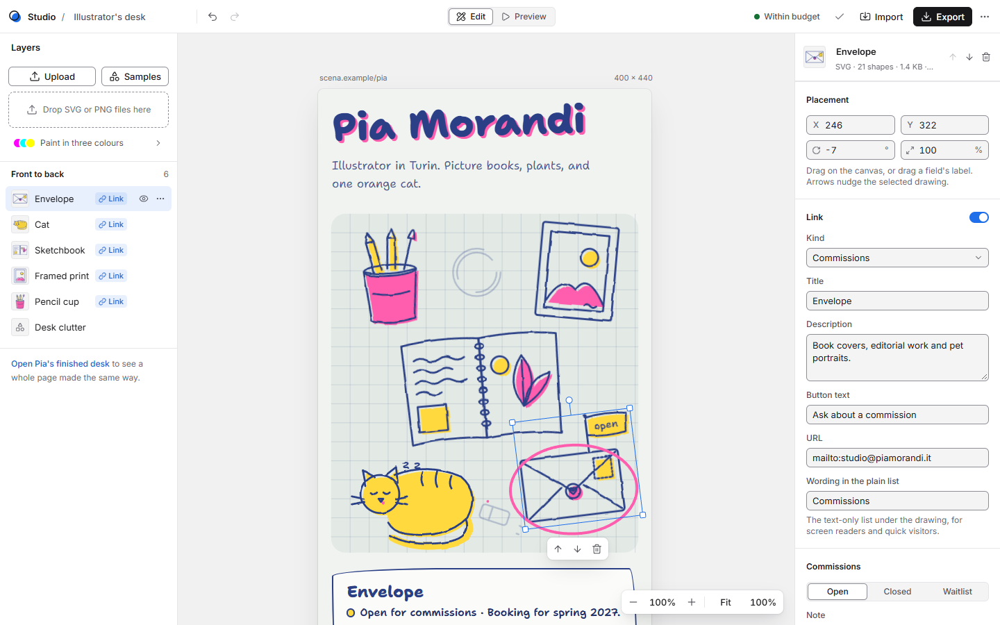
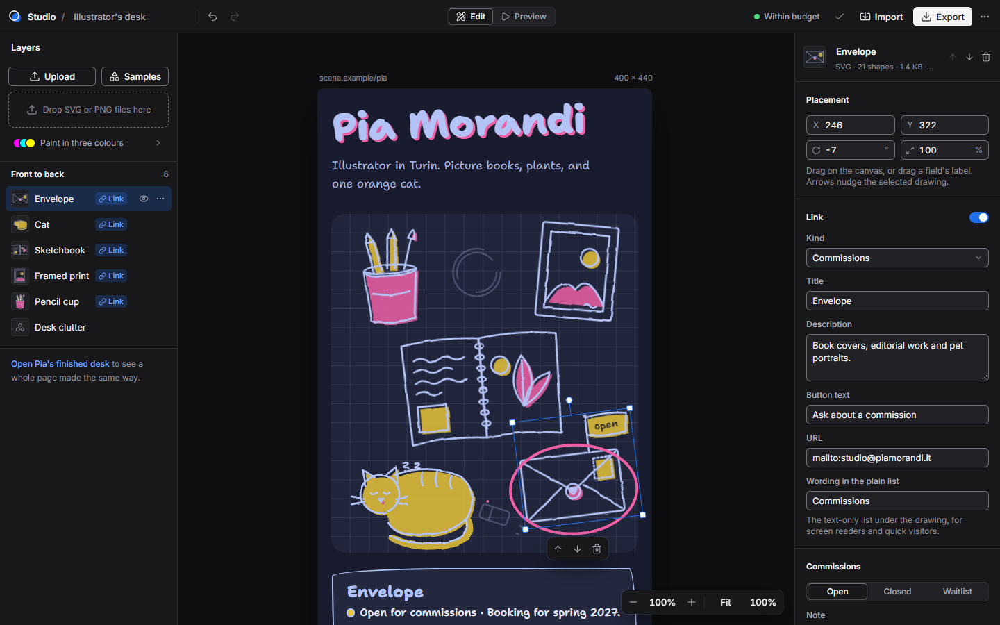
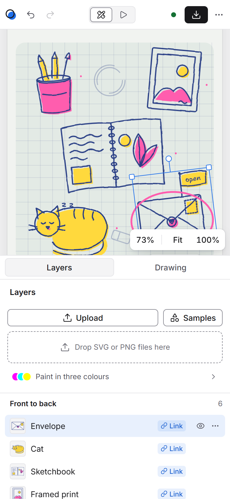

# Studio UI

The studio is a tool around a canvas. The canvas is the user's page, live: header, mat, drawings,
reveal panel and plain list, drawn by the published renderer in the page's riso style (Shantell
Sans, wobbly borders, two-colour palettes). Everything around it is the tool, and it has its own
quiet design so the page carries all the colour and personality.

Principles:

- **Neutral chrome, one accent.** Greys do the structure; a single blue marks selection, focus
  and "on". Primary actions are ink (near-black, or near-white in dark mode), not blue, so the
  accent never competes with the page.
- **Precise, not decorative.** 1 px hairlines, a 4 px grid, three radii, shadows only on things
  that float.
- **The page is never restyled.** Chrome tokens are `--ui-*`; page tokens (`--paper`, `--line`,
  `--accent1` and so on) belong to the renderer and stay inside `.stage`. Shantell Sans never
  appears outside the canvas.





The screenshots come from `pnpm shots` (headless Chrome, Pia's desk with the envelope selected).

## Tokens

All tokens are at the top of `apps/studio/src/studio.css`. The chrome follows the OS light or
dark setting through `prefers-color-scheme`. The page on the canvas follows its own Light, Dark
or Auto setting, independently.

### Colour

| Token | Light | Dark | Use |
|---|---|---|---|
| `--ui-workspace` | `#F1F1F2` | `#0E0E10` | the area the page floats in |
| `--ui-panel` | `#FFFFFF` | `#18181B` | bar, panels, menus, dialogs |
| `--ui-field` | `#F4F4F5` | `#222226` | text fields, segmented tracks, thumbnails |
| `--ui-line` | `#E6E6E9` | `#2A2A2F` | 1 px hairlines between regions |
| `--ui-control` | `#8E8E97` | `#6E6E79` | borders of interactive controls (3:1 against the panel) |
| `--ui-control-hover` | `#6B6B74` | `#8E8E98` | the same, hovered |
| `--ui-hover`, `--ui-pressed` | ink at 5%, 9% | white at 6%, 10% | row and button states |
| `--ui-text` | `#18181B` | `#F4F4F5` | primary text |
| `--ui-text-2` | `#52525B` | `#A8A8B2` | labels, secondary text |
| `--ui-text-3` | `#6B6B74` | `#8E8E98` | hints, counts, meta |
| `--ui-ink`, `--ui-on-ink` | `#18181B`, `#FFFFFF` | `#F4F4F5`, `#18181B` | primary buttons, the toast |
| `--ui-accent` | `#1F6FEB` | `#1F6FEB` | selection handles, focus ring, switches when on, the selected palette |
| `--ui-accent-text` | `#1A5FD0` | `#78A6FF` | the accent used as text (links, the Link badge) |
| `--ui-accent-soft` | accent at 10% | accent at 22% | selected layer row, badge and drop target fills |
| `--ui-ok`, `--ui-warn`, `--ui-danger` | `#157034`, `#9A4A06`, `#C42B1C` | `#4ADE80`, `#FBBF24`, `#F87171` | budget status, field messages, destructive items |

Why this blue: the page palettes are riso pairs (fluo pink, yellow, lime, teal, violet, orange)
on cream or navy. A clean, slightly cool blue, close to the system selection colour designers
already read as "selected", is the one hue none of them use, so a handle is never mistaken for
art. It keeps at least 3:1 against both workspaces and against the page paper colours (see
below), so the 1 px handles stay visible on any palette.

### Contrast (WCAG 2.2 AA)

Text needs 4.5:1. Control boundaries, focus indicators and icons need 3:1. Measured:

| Pair | Light | Dark |
|---|---|---|
| text on panel, workspace, field | 17.7, 15.7, 16.1 | 16.1, 17.5, 14.4 |
| text-2 on panel, field | 7.7, 7.0 | 7.5, 6.7 |
| text-3 on panel, field, workspace | 5.3, 4.8, 4.7 | 5.5, 4.9, 5.9 |
| accent-text on panel, on accent-soft | 5.9, 5.1 | 7.3, 5.9 |
| text on a selected row (accent-soft) | 15.6 | 12.9 |
| white on accent (switch knob) | 4.6 | 4.6 |
| on-ink on ink (primary button, toast) | 17.7 | 16.1 |
| ok, warn, danger on panel | 6.2, 6.3, 5.7 | 10.2, 10.6, 6.4 |
| control border on panel (non-text) | 3.3 | 3.5 |
| focus ring (accent) on panel, workspace | 4.6, 4.1 | 3.8, 4.2 |
| danger icon in the toast | 9.3 | 5.2 |

Disabled controls (Undo with nothing to undo, a menu item that cannot apply) are exempt and drawn
faded, at 35% to 45% opacity. The accent also keeps 3.2:1 or more against every page paper and
mat colour in all five palettes, light and dark, so the handles read on any page.

### Type

Inter (400, 500, 600) from Google Fonts, with `cv11` and `ss01` for the single-storey a and open
digits, falling back to the system UI stack offline. Numbers in fields and readouts use tabular
figures.

| Token | Size / line height | Use |
|---|---|---|
| `--ui-xs` | 11 / 16 | badges, menu labels, the frame label |
| `--ui-sm` | 12 / 16 | hints, meta, counts, the budget pill |
| `--ui-md` | 13 / 20 | the base: controls, fields, rows; section titles at 600 |
| `--ui-lg` | 15 / 22 | dialog and empty-state titles, at 600 |

Weights: 400 for text, 500 for controls and labels that need weight, 600 for titles. No other sizes.

### Space, lines, radii, elevation

- Spacing is a 4 px scale: `--ui-1` 4, `--ui-2` 8, `--ui-3` 12, `--ui-4` 16, `--ui-5` 20,
  `--ui-6` 24, `--ui-8` 32. Panels are inset 16 px, rows 8 px.
- Lines: 1 px `--ui-line` between regions, 1 px `--ui-control` around controls.
- Radii: 4 (badges, thumbnails, knobs), 6 (controls, rows), 8 (cards, menus, popovers, the page).
  Dialogs use 12; the phone frame uses its own device radius.
- Controls are 28 px high; the bar is 48 px; the Layers panel is 256 px and the Inspector 296 px.
- Shadows only on floating surfaces: `--ui-shadow-pop` for menus, popovers, the toast, the zoom
  control and the selection toolbar, and `--ui-shadow-page` for the page and the device frame.

### Icons

[Lucide](https://lucide.dev) through `lucide-react` 1.70.0, stroke 1.75, 16 px in controls and
14 px in dense places. An icon always sits next to a visible label, or carries an `aria-label`
and a tooltip. The product mark is two offset circles, an outline and an accent fill, a nod to
riso misregistration.

### Motion

`--ui-ease` is `cubic-bezier(0.2, 0, 0, 1)`, a quick ease-out. `--ui-fast` (120 ms) is for hover
and press, `--ui-base` (160 ms) for menus, popovers, dialogs and the toast. Nothing in the chrome
moves on its own. With reduced motion, every chrome transition drops to 1 ms.

The page's own boil is separate: it follows the page's Motion setting and the OS. When the OS
reduces motion, the studio shows an "Animate" switch on the canvas; it applies to the canvas and
the preview only, never to the export.

## Layout

```
+---------------------------------- bar, 48 -----------------------------------+
| (o) Studio / Scene name  undo redo | [Edit|Preview] | * Within budget  ok  Import  [Export]  ... |
+-----------+-----------------------------------------------+------------------+
| Layers    | workspace                                     | Inspector        |
| 256       |   scena.example/pia               400 x 440   | 296              |
| Upload    |   +-------------------+                       | Placement        |
| Samples   |   |  the page (live)  |                       | Link             |
| drop zone |   +-------------------+                       | Commissions      |
| colours   |                     [- 100% + | Fit 100%]     | Tap area         |
| rows      |                                               | (or the Page)    |
+-----------+-----------------------------------------------+------------------+
```

- **Top bar.** The product mark and "Studio", then the scene name as an inline text field, then
  Undo and Redo. Edit/Preview is a segmented control in the exact centre; in Preview it gains the
  device (phone or full width) and page-appearance controls. On the right:
  - the budget pill, a status dot and a summary that opens the checks in a popover;
  - the autosave indicator, a quiet check, or a warning when the work is too big for browser
    storage;
  - Import, and Export (the one primary button);
  - an overflow menu with Import, "Open Pia's finished desk" and "Start over…".
- **Layers.** Upload, a Samples menu with thumbnails of Pia's sketches, and a dashed drop target.
  Under them, "Paint in three colours" shows the three sentinel swatches as a compact row; it
  opens a popover that maps each swatch to the palette colour it becomes.

  The rows run front to back. Each has a thumbnail rendered by the page renderer, the name, a
  frames badge with the frame count for animated drawings, a Link badge for clickable drawings,
  and, on hover or selection, a visibility toggle and a menu (forward, back, delete). Rows reorder by dragging; the pointer is captured only after 5 px, so
  clicks still select. On the keyboard, Alt+Up and Alt+Down reorder, Up and Down move between
  rows, and Delete removes.
- **Workspace.** A neutral surface with the page floating at fit-to-width. On a desktop, Fit also
  keeps the header and the drawing in view, and never goes above 100%, so PNGs stay sharp.
  - A frame label shows the address and the canvas size.
  - The zoom control (minus, readout, plus, Fit, 100%) floats bottom right.
  - Ctrl or Cmd with the wheel, or a pinch, zooms. Shift+1 fits and Shift+0 is 100%.
  - Pressing the empty workspace clears the selection.
- **Selection.** A 1 px accent box with four square corner knobs (resize about the centre) and a
  round knob on a stalk (rotate). The handles stay the same size on screen at any zoom, and so do
  their hit areas: 40 px across, as before the redesign. A small upright toolbar (forward, back,
  delete) floats under the rotated box.
- **Inspector, drawing selected.**
  - A header: thumbnail, name, what the drawing is, order and delete.
  - Placement: X, Y, rotation and size as numeric fields. Drag a field's icon or letter to scrub.
  - Frames (see below).
  - Link: a switch makes the drawing clickable. Then kind, title, description, button text, URL
    with inline validation, and the wording in the plain list.
  - Commissions: status and note, for commission links.
  - Tap area.
- **Inspector, nothing selected.** The Page: profile, palette swatches, light or dark, motion,
  canvas surface and size, the words around the drawing, and the keyboard shortcuts.
- **Empty state.** A card centred on the empty mat: "Add your first drawing", with Upload and Add
  a sample. It is chrome, so it sits outside the page's CSS and does not scale with the zoom.
- **Frames** ([ADR 0002](../adr/0002-frame-animation.md)). A collapsible section under Placement.
  - Before a drawing has frames, the section shows one line of explanation and a dashed "Add
    frames" target. Choose files, or drop them on the section.
  - With frames, it shows a strip of 52 px frame thumbnails, numbered, ending in a dashed add
    tile that is also a drop target.
  - Clicking a frame holds the canvas on it. While the section is open, the other frames show
    at 20% behind it (the onion skin), to check registration. The held frame gets an accent
    outline, the same as a selected palette chip.
  - On the keyboard, Left and Right choose a frame, Alt with an arrow reorders, and Delete
    removes. The strip is one tab stop.
  - A small toolbar under the strip says "Playing" or "Frame 2 of 3", with move-earlier,
    move-later and remove buttons.
  - Then: a Speed slider from 2 to 12 fps, with the readout in animators' words ("6 fps, on
    twos"); "Plays" (Always, On hover, While selected, Once on tap; decorations get Always only,
    with a hint to turn on Link); and two switches with one-line hints, "Play on the canvas" and
    "Boil the frames too".
  - A closing note gives the shared box, so the author knows the frames line up. The
    description line in the header says the same ("3 frames at 6 fps in one 72×104 box").
- **Several drawings at once.** Dropping or choosing two or more drawings of one kind opens a
  small dialog: "Add 3 drawings". It has two large choices in the style of the export rows, "One
  drawing with 3 frames" (film icon) and "3 separate drawings" (copy icon), and Cancel. An
  animated PNG or WebP skips the question: it becomes frames.
- **Preview.** The panels go away and the exact exported page runs in a sandboxed iframe. It sits
  in a phone frame (375 px wide) or in a browser window with the page address. Taps inside it work
  as on the published page.
- **Phone, below 900 px.** One column:
  - the bar, then the canvas;
  - a tab bar: Layers, and Drawing or Page;
  - the active panel as a bottom sheet, 44% of the height.

  Picking a drawing on the canvas switches to its settings; picking it in the list stays in the
  list. Fit is width-only and the page scrolls. Labels in the bar collapse to icons, which keep
  their accessible names. There is no horizontal scrolling at 375 px.

## Components

Thin wrappers in `apps/studio/src/components/ui.tsx`, so every surface looks and behaves the same:

- `Button` (default outline, `primary` ink, `ghost`, `danger`) and `IconButton` (28 or 24 px,
  always with a tooltip and an accessible name).
- `Segmented`: native radios in a `radiogroup`, so the arrow keys work. The selected item is a
  raised chip in the panel colour with a control-coloured border.
- `Switch`: a native checkbox with `role="switch"`.
- `TextField`, `SelectField` and `NumberField`, with counters and inline messages. Errors and
  warnings carry an icon as well as colour. In a `NumberField`, the prefix icon or letter scrubs
  by dragging, and Enter or blur commits.
- `Menu`, `Popover` and `Tip`: Radix primitives styled with the tokens above.
- Dialogs are native `<dialog>` elements; the browser provides the focus trap, Escape and the
  backdrop.
- `FramesSection` (`components/FramesSection.tsx`) and the frames-or-separate dialog reuse
  these pieces: the drop target, the export dialog's choice rows, the switch rows, and the
  accent outline for "this one is chosen".
- The toast drops in under the bar and is visual only. The same message goes to a polite live
  region, once.

Focus is a 2 px accent outline with a 2 px offset on everything (`:focus-visible`), inset on list
rows. Skip links to the canvas and the inspector come first in the tab order.

## Dependencies

| Package | Version | Why |
|---|---|---|
| `lucide-react` | 1.70.0 | One consistent, open-licensed icon family with a light stroke that suits Inter; tree-shaken to the icons used. |
| `@radix-ui/react-dropdown-menu` | 2.2.1 | Menus need roving focus, typeahead, Escape, focus return and collision-aware placement; doing that well by hand is a project of its own. |
| `@radix-ui/react-popover` | 1.3.1 | The budget checks and the colour help: focus management, dismissal and placement. |
| `@radix-ui/react-tooltip` | 1.4.1 | Tooltips on hover and on keyboard focus, with a shared delay, for every icon button. |

All four are headless (they bring no styles) and are pinned to exact versions. There is no CSS
framework: the chrome is one hand-written stylesheet on custom properties.

## Decisions we are least sure of

1. **Blue as the accent.** It is the safest selection colour next to any riso palette, and it
   reads as a tool rather than a brand. A brand colour, or the page's own accent, would make the
   studio feel more like the product but would clash with some palettes. Worth testing with
   illustrators.
2. **Fit never goes above 100%.** That keeps PNG drawings sharp and shows the page at its true
   size, but on a large monitor the page sits small in the workspace until you zoom in.
3. **Hide means "not published".** Visibility uses fields the format already has. A hidden link
   is turned off, so the renderer leaves it out. A hidden decoration gets opacity 0 and still
   ships in the file, so it still counts toward the page weight. Showing it again restores its
   previous opacity from the studio's stash, which is not exported. This needs no format change.
